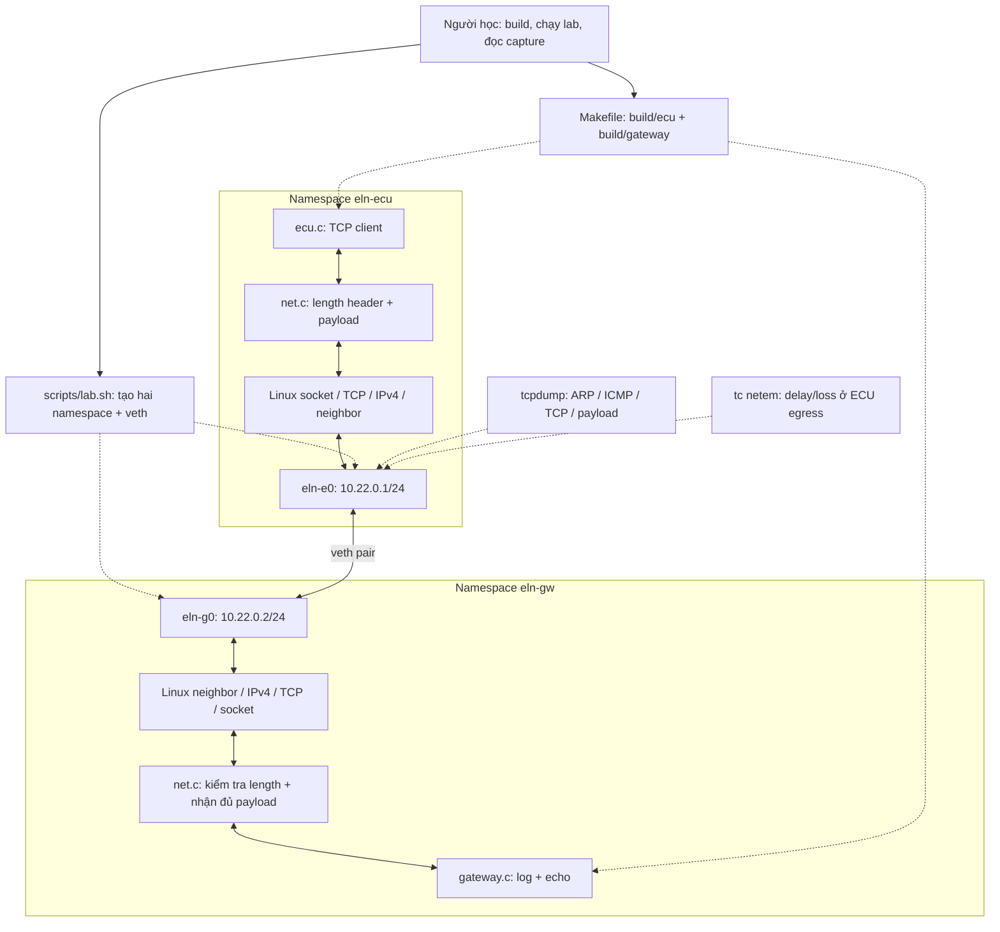
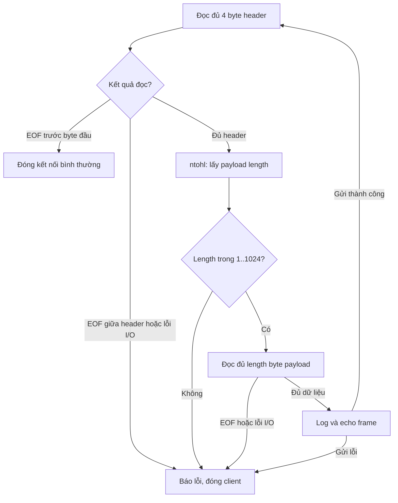
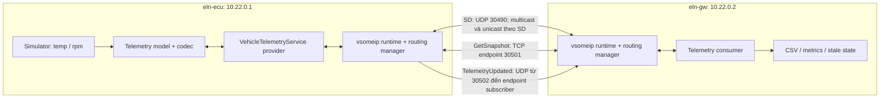
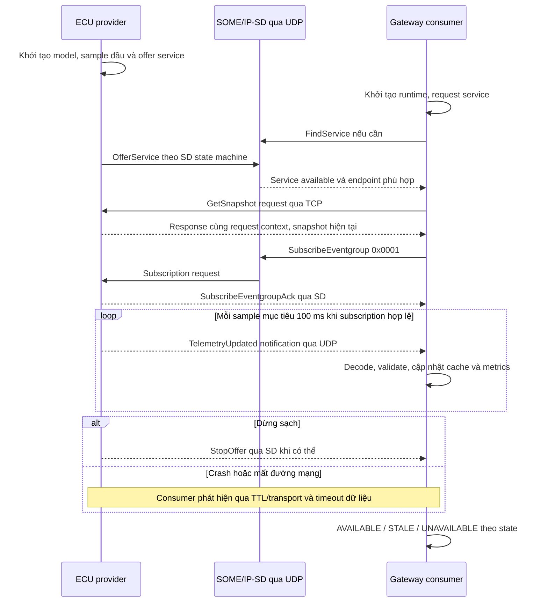
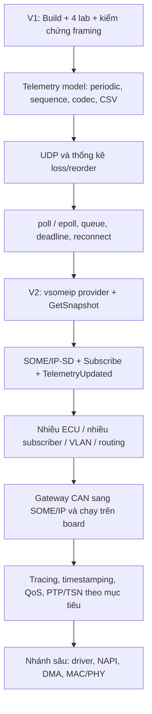
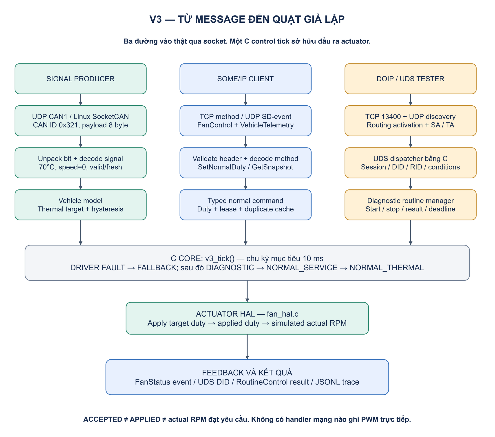

# Virtual ECU Telemetry Lab — Giải thích thiết kế, workflow và specification

**Phiên bản tài liệu:** 1.2 · **Cập nhật:** 14/11/2026 · **Đối tượng:** người học Embedded Linux Networking từ cơ bản đến Automotive Ethernet, SOME/IP và DoIP/UDS.

Tài liệu này là bản giải thích tổng thể cho project trong thư mục `linux_networking`. Đọc từ trên xuống để hiểu hệ thống, hoặc dùng mục lục để tra cứu khi code và debug.

**Quy ước trạng thái:** `ĐÃ VIẾT` nghĩa là đã có trong source; `CHƯA CHẠY LINUX` nghĩa là chưa được chứng minh bằng runtime; `ĐỀ XUẤT` là yêu cầu thiết kế cho bước tiếp theo. Viết spec không đồng nghĩa tính năng đã được triển khai.

**Bổ sung ngày 10/11/2026:** đã thêm bản [gửi ảnh TCP bằng C với workflow/UML xuất PNG từ draw.io](docs/04-image-transfer.md). Bản này có protocol IMG1 riêng, không đổi framing telemetry V1. Các trạng thái V1/V2/V3 trong tài liệu dưới đây vẫn chỉ áp dụng đúng phạm vi từng bản.

## Mục lục

1. [Mục tiêu và phạm vi hiện tại](#1-mục-tiêu-và-phạm-vi-hiện-tại)
2. [Sơ đồ tổng thể và working flow](#2-sơ-đồ-tổng-thể-và-working-flow)
3. [Giải thích những file đã tạo](#3-giải-thích-những-file-đã-tạo)
4. [Specification V1: TCP telemetry hiện tại](#4-specification-v1-tcp-telemetry-hiện-tại)
5. [Kiểm thử, bằng chứng và cách debug](#5-kiểm-thử-bằng-chứng-và-cách-debug)
6. [Từ Linux networking đến Automotive Ethernet](#6-từ-linux-networking-đến-automotive-ethernet)
7. [Specification V2: SOME/IP Telemetry Service](#7-specification-v2-someip-telemetry-service)
8. [Lộ trình triển khai và hướng phát triển](#8-lộ-trình-triển-khai-và-hướng-phát-triển)
9. [Thuật ngữ và tài liệu tham chiếu](#9-thuật-ngữ-và-tài-liệu-tham-chiếu)
10. [V3: DoIP, signal và actuator](#10-v3-doip-signal-và-actuator)

## 1. Mục tiêu và phạm vi hiện tại

### 1.1. Bài toán học tập

Giả sử một ECU có dữ liệu nhiệt độ và tốc độ động cơ. ECU cần gửi dữ liệu đến một chương trình gateway để nhận, kiểm tra và quan sát quá trình truyền qua mạng.

Project bắt đầu với dữ liệu giả lập nhập từ command line. Ví dụ:

```text
ecu=1,seq=1,temp_c=42,rpm=1200
```

Bạn sẽ học được ba câu hỏi liên tiếp:

1. **Ứng dụng giao tiếp thế nào?** Socket, địa chỉ, port, kết nối TCP, đóng/mất kết nối.
2. **Linux đưa dữ liệu đến đúng nơi thế nào?** Interface, subnet, route, neighbor/ARP, network namespace.
3. **Làm sao biết lỗi ở đâu?** Log ứng dụng, `ip`, `ss`, `tcpdump`, capture và fault injection.

Từ nền đó, project phát triển thành service dữ liệu dùng SOME/IP, rồi tích hợp Ethernet thật và CAN ở các mốc sau.

### 1.2. Trạng thái thực tế

| Hạng mục | Trạng thái | Ý nghĩa chính xác |
| --- | --- | --- |
| TCP client/server V1 viết bằng C | ĐÃ CROSS-BUILD, CHƯA CHẠY LINUX | Có source/Makefile và đã cross-build Linux; runtime Linux chưa xác nhận |
| Header length, partial I/O, giới hạn frame | ĐÃ VIẾT, CHƯA CHẠY LINUX | Có đường xử lý và integration tests tương ứng |
| Hai namespace nối bằng veth | ĐÃ VIẾT, CHƯA CHẠY LINUX | Có script; chưa tạo topology tại phiên làm việc Windows |
| Bốn lab tiếng Việt | ĐÃ VIẾT | Có thao tác, kết quả kỳ vọng và câu hỏi tự đánh giá |
| Bộ integration tests V1 | ĐÃ VIẾT, CHƯA CHẠY LINUX | 9 test methods V1; không gộp kết quả 59 tests của V3 |
| Cú pháp Bash/Python | ĐÃ KIỂM TRA | Bash syntax, Python AST và guard từ chối chạy ngoài Linux đã được kiểm tra |
| V1 mở rộng UDP/reconnect/`epoll`, router/VLAN | BƯỚC HỌC TIẾP | Không nhầm với UDP và asyncio adapters đã có trong V3 |
| SOME/IP method/event và SD unicast | ĐÃ TRIỂN KHAI TRONG V3 | Runtime subset, xem `docs/05-v3-running-lab.md`; CAN gateway đa ECU vẫn là bước sau |
| DoIP/UDS, signal-to-actuator, diagnostic routine V3 | ĐÃ CHẠY END-TO-END TRÊN WINDOWS | C core + Python adapters, test và interop; SocketCAN/namespace Linux chưa chạy |

### 1.3. Các quyết định thiết kế ban đầu

| Quyết định | Lý do học tập | Hệ quả |
| --- | --- | --- |
| C và socket API trực tiếp | Nhìn rõ syscall, buffer, lỗi và tài nguyên | Bạn cần hiểu pointer, struct, byte order |
| Server blocking, xử lý tuần tự | Luồng thực thi ngắn, dễ đọc/debug | Một client đang hoạt động giữ các client khác phải chờ |
| Payload text, header binary | Dễ nhìn dữ liệu nhưng vẫn học framing | Chưa có schema telemetry được server kiểm tra |
| Mạng ảo nội bộ | Thực hành Linux stack trước khi có board | Chưa kiểm tra được PHY/MAC/DMA của phần cứng thật |
| Echo nguyên dữ liệu | Có phản hồi để client đối chiếu từng byte | Chưa có xử lý nghiệp vụ, lưu dữ liệu hoặc điều khiển |

## 2. Sơ đồ tổng thể và working flow

Các sơ đồ dùng Mermaid. Nếu trình xem Markdown không render Mermaid, dùng sơ đồ text và phần diễn giải ngay bên dưới.

### 2.1. Kiến trúc V1 đang có



Sơ đồ rút gọn:

```text
Nguồn C ── make ──► hai chương trình
                         │
ECU application ── socket/TCP/IP ── eln-e0 ══ veth ══ eln-g0 ── TCP/IP/socket ── Gateway
      ▲                                                                             │
      └────────────────── phản hồi echo cùng payload ────────────────────────────────┘
                         │
                   tcpdump quan sát
                   tc netem gây lỗi
```

Hai namespace dùng chung kernel của máy Linux, nhưng có tài nguyên mạng được cô lập. Chúng không phải hai máy ảo và không có hai kernel riêng. [Linux network namespaces](https://man7.org/linux/man-pages/man7/network_namespaces.7.html)

### 2.2. Workflow để chạy một vòng thực hành

```mermaid
flowchart LR
    A["Chuẩn bị Ubuntu + compiler"] --> B["make"]
    B --> C["Loopback: 127.0.0.1"]
    C --> D["lab.sh up"]
    D --> E["Chạy gateway trong eln-gw"]
    E --> F["Bắt gói trước khi chạy client"]
    F --> G["Chạy ECU trong eln-ecu"]
    G --> H["Đối chiếu ACK, log, capture"]
    H --> I["Thử delay/loss và kiểm tra lại"]
    I --> J["Ghi nhật ký + dừng process"]
    J --> K["lab.sh down"]
```



Thứ tự này giúp tách lỗi: loopback chạy được mới chuyển sang topology namespace. Nếu demo loopback đã lỗi thì chưa cần điều tra veth hay ARP.

### 2.3. Trình tự một lần gửi telemetry

```mermaid
sequenceDiagram
    participant U as Người học
    participant E as ECU application
    participant EK as Linux stack ECU
    participant GK as Linux stack Gateway
    participant G as Gateway application
    U->>G: Chạy gateway: socket, bind, listen
    Note over G: Blocking tại accept()
    U->>E: Chạy ecu với IP, port, payload
    E->>EK: socket(), connect()
    opt Neighbor cache chưa có MAC
        EK->>GK: ARP request
        GK-->>EK: ARP reply
    end
    EK->>GK: TCP SYN
    GK-->>EK: TCP SYN/ACK
    EK->>GK: TCP ACK
    Note over E,G: Handshake do kernel xử lý; ứng dụng nhận kết quả qua socket API
    GK-->>G: accept() trả về connected socket
    E->>EK: send_frame(): header 4 byte + payload
    EK->>GK: TCP stream qua veth
    GK-->>G: recv_frame(): đọc đủ header và payload
    G->>G: In log RX
    G-->>E: send_frame(): echo cùng payload
    E->>E: So sánh length và từng byte; in Application ACK
    E->>EK: close()
    Note over G: recv() thấy EOF: đóng client, quay về accept()
```

Đây là thứ tự logic. Kernel có thể gộp dữ liệu vào segment, trì hoãn ACK hoặc chia dữ liệu khác với các lần gọi `send()`. TCP không giữ ranh giới message ứng dụng. [Linux TCP](https://man7.org/linux/man-pages/man7/tcp.7.html)

### 2.4. State machine nhận một frame



V1 thực hiện state machine này bằng các vòng lặp blocking. Khi chuyển sang `epoll`, cần lưu state, số byte đã đọc và buffer riêng cho từng connection.

## 3. Giải thích những file đã tạo

### 3.1. Bản đồ thư mục

```text
linux_networking/
├── README.md                  Điểm bắt đầu, chạy nhanh và giới hạn
├── PROJECT_DESIGN_SPEC.md      Tài liệu tổng thể này
├── Makefile                   Build, test, clean
├── .gitattributes             Quy định LF khi Git xử lý source/script
├── .gitignore                 Bỏ qua binary, capture và cache
├── src/
│   ├── ecu.c                  TCP client
│   ├── gateway.c              TCP server
│   ├── net.h                  Interface dùng chung, FRAME_MAX
│   └── net.c                  Endpoint, timeout và framing
├── scripts/lab.sh             Quản lý topology và netem
├── tests/test_tcp.py          Integration tests trên loopback
├── docs/
│   ├── 00-setup.md            Chuẩn bị Linux
│   ├── 01-labs.md             Bốn bài thực hành
│   └── 02-roadmap.md          Các milestone học tập
└── notes/journal.md           Mẫu ghi chép và checklist
```

`build/` sinh khi chạy `make`; `captures/` được tạo khi làm bài capture. Chúng không phải source cần đọc trước.

### 3.2. `src/ecu.c`: bên gửi

Luồng xử lý:

1. Nhận ba đối số: IPv4 gateway, port, chuỗi telemetry.
2. Gọi `endpoint()` để tạo `sockaddr_in` và kiểm tra địa chỉ/port.
3. Kiểm tra độ dài chuỗi bằng `strlen()`: phải từ 1 đến 1024 byte.
4. Tạo socket `AF_INET`, `SOCK_STREAM`.
5. Đặt timeout và gọi `connect()`.
6. Gọi `send_frame()` để gửi header, sau đó payload.
7. Gọi `recv_frame()` để nhận phản hồi.
8. Đóng socket; đối chiếu length và `memcmp()` với dữ liệu đã gửi.
9. Thành công: in `Application ACK`, trả exit code 0. Thất bại: thông báo stderr và exit code 1.

**Điểm cần hiểu:** client hiện gửi đúng một message rồi kết thúc. Gateway có thể đọc nhiều message trên cùng connection, nhưng tính năng gửi định kỳ chưa có ở client. Dữ liệu cảm biến là chuỗi demo; không có driver cảm biến hoặc bộ đọc CAN.

### 3.3. `src/gateway.c`: bên nhận

Gateway tạo một **listening socket** và bật `SO_REUSEADDR`, sau đó `bind()` vào địa chỉ do người dùng chọn, `listen(..., 8)` rồi chờ `accept()`.

Mỗi lần `accept()` thành công, kernel trả về một **connected socket** mới. Listening socket tiếp tục tồn tại. Gateway đặt timeout cho connected socket, đọc frame trong vòng lặp, in log RX và gửi lại nguyên payload. Khi client đóng/lỗi/timeout, gateway đóng connected socket rồi quay về `accept()`.

`listen(..., 8)` cấu hình backlog, không tạo tám worker. Một client gửi đều đặn có thể giữ connection lâu, làm các client đang chờ không được ứng dụng xử lý ngay.

`SO_REUSEADDR` giúp việc khởi động lại server thuận tiện trong lab; nó không phải cơ chế cho nhiều server tùy ý chiếm cùng endpoint. Log dùng line buffering để dễ nhìn khi chạy terminal hoặc redirect.

### 3.4. `src/net.c` và `src/net.h`: phần giao thức dùng chung

| Hàm/hằng | Công việc | Lý do cần |
| --- | --- | --- |
| `FRAME_MAX` | Giới hạn payload 1024 byte | Ràng buộc trước khi nhận vào buffer cố định |
| `endpoint()` | Parse port, kiểm tra IPv4, tạo địa chỉ socket | Tránh dùng đối số sai và xử lý host/network byte order cho port |
| `socket_timeout()` | Đặt `SO_RCVTIMEO`, `SO_SNDTIMEO` bằng 5 giây | Hạn chế chờ vô thời hạn ở một thao tác blocking |
| `send_all()` | Gửi tiếp phần còn lại, retry khi `EINTR` | Một `send()` có thể ghi ít hơn số byte yêu cầu |
| `recv_exact()` | Đọc tiếp cho đến đủ số byte, EOF hoặc lỗi | Một `recv()` có thể trả về một phần dữ liệu |
| `send_frame()` | Kiểm tra length, `htonl()`, gửi header và payload | Hai bên hiểu cùng một framing |
| `recv_frame()` | Đọc header, `ntohl()`, kiểm tra length, đọc payload | Phân biệt message trong TCP stream |

`MSG_NOSIGNAL` ở đường gửi giúp ứng dụng nhận lỗi syscall khi peer đã đóng thay vì bị kết thúc bởi SIGPIPE ở thao tác gửi đó. `EINTR` được thử lại; các lỗi khác được trả lên caller. Giá trị trả về `recv_frame()` là `1` cho frame đủ, `0` cho EOF hợp lệ giữa hai frame, `-1` cho lỗi.

Ví dụ bản tin bị chia khi nhận:

```text
Wire format: 00 00 00 05 h e l l o
recv #1:    00 00
recv #2:    00 05 h e
recv #3:    l l o
```

Ứng dụng phải ghép đủ byte; không được hiểu `recv #2` là một message riêng. [Linux recv](https://man7.org/linux/man-pages/man2/recv.2.html)

### 3.5. `scripts/lab.sh`: mạng thực hành

| Lệnh | Thao tác |
| --- | --- |
| `up` | Tạo `eln-ecu`, `eln-gw`, một veth pair; chuyển đầu veth vào namespace; gán IP; bật lo và veth |
| `status` | Hiển thị địa chỉ, route và neighbor của hai namespace |
| `ping` | Gửi 4 ICMP echo từ ECU đến gateway |
| `delay` | Đặt netem 50 ms delay và 1% random loss trên egress `eln-e0` |
| `clear` | Gỡ root netem của interface ECU nếu đang có |
| `down` | Kiểm tra không còn process trong namespace rồi xóa hai namespace |

Script kiểm tra Linux, quyền root, công cụ `ip`; từ chối `up` nếu tên tài nguyên đã tồn tại. Nhánh tạo có rollback để cố dọn tài nguyên vừa tạo nếu một lệnh thất bại. Các tên `eln-ecu`, `eln-gw`, `eln-e0`, `eln-g0` phải được dành riêng cho lab.

Script không bật IP forwarding, không cấu hình default route/NAT/firewall host, không nối lab ra Internet. Hai địa chỉ cùng subnet nên topology V1 chưa cần router. `netem` đang áp dụng một chiều ECU → gateway; một ping request và reply không cùng đi qua qdisc đó theo chiều egress.

### 3.6. Build, test và tài liệu

`Makefile` build C11 với debug symbols, bật warning và coi warning là lỗi. Chế độ mặc định `-O0 -g3` ưu tiên học/debug. `make test` build rồi chạy Python unittest; Python đóng vai trò peer kiểm thử, không thay thế ứng dụng C.

`.gitattributes` đặt `.sh`, `.c`, `.h` và Makefile dùng LF qua Git; `.gitignore` bỏ qua output build/capture/cache. Ba tài liệu trong `docs/` đưa bạn từ setup đến thực hành và milestone; `notes/journal.md` lưu bằng chứng học tập. Chưa tự động khởi tạo Git repository, CI hoặc deploy lên board.

## 4. Specification V1: TCP telemetry hiện tại

**Tên:** ELN-TCP-V1 · **Trạng thái:** mô tả source hiện có, runtime chưa xác nhận · **Mục đích:** thống nhất hành vi để học và kiểm thử.

Trong spec này, **PHẢI** là điều kiện bắt buộc của V1; **NÊN** là khuyến nghị vận hành. Tham số lab không phải yêu cầu của AUTOSAR hoặc của một hãng xe.

### 4.1. System contract

| Thuộc tính | Giá trị V1 |
| --- | --- |
| Target | Linux userspace có IPv4/TCP; namespace/veth cần kernel và quyền phù hợp |
| Ngôn ngữ/build | C11, `make`, compiler tương thích GCC/Clang trên Linux |
| Chương trình | `gateway BIND_IPV4 PORT`; `ecu GATEWAY_IPV4 PORT PAYLOAD` |
| Transport | TCP/IPv4; địa chỉ nhập dạng số |
| Port hợp lệ | 1–65535; lab sử dụng 5000 theo cấu hình CLI |
| Loopback | `127.0.0.1:5000` |
| Topology namespace | ECU `10.22.0.1/24`; gateway `10.22.0.2/24` |
| Connection model | Gateway phục vụ tuần tự; một connection có thể chứa nhiều frame |
| Client hiện tại | Một request và một echo response rồi đóng |
| Storage | Log stdout/stderr, chưa ghi database hoặc CSV |

### 4.2. Wire contract

| Offset | Kích thước | Tên | Quy tắc |
| --- | --- | --- | --- |
| 0 | 4 byte | `payload_length` | `uint32`, big-endian; không tính 4 byte header |
| 4 | `payload_length` byte | `payload` | 1–1024 byte; không có NUL terminator bắt buộc trên wire |

Tổng frame dài `4 + payload_length` byte. Ví dụ golden vector:

```text
Payload: hello
Hex:     00 00 00 05 68 65 6c 6c 6f
```

Gateway coi payload là dãy byte và echo nguyên vẹn. CLI của ECU tạo payload từ chuỗi, không gửi được embedded NUL. UTF-8 là quy ước demo, chưa có UTF-8 validator; `temp_c`, `rpm`, `seq` hiện không được parse. Log `%.*s` không biểu diễn chính xác binary chứa NUL và không escape control characters.

### 4.3. Yêu cầu chức năng

| ID | Yêu cầu PHẢI | Vị trí source |
| --- | --- | --- |
| V1-F01 | Từ chối sai số đối số, IPv4 lỗi hoặc port ngoài khoảng | `ecu.c`, `gateway.c`, `endpoint()` |
| V1-F02 | Client từ chối payload rỗng hoặc vượt 1024 byte trước khi gửi | `ecu.c` |
| V1-F03 | Sender gửi header length ở network byte order | `send_frame()` |
| V1-F04 | Receiver đọc đủ header và payload dù phải gọi recv nhiều lần | `recv_exact()`, `recv_frame()` |
| V1-F05 | Receiver không nhận payload length 0 hoặc lớn hơn 1024 | `recv_frame()` |
| V1-F06 | Gateway phản hồi nguyên payload, giữ đúng thứ tự frame trên connection | `gateway.c` |
| V1-F07 | Client kiểm tra phản hồi bằng length và từng byte | `ecu.c` |
| V1-F08 | EOF giữa hai frame là đóng hợp lệ; EOF trong frame là lỗi | `recv_frame()` |
| V1-F09 | Lỗi của một client đóng connection đó; server tiếp tục accept nếu listener còn hoạt động | `gateway.c` |
| V1-F10 | Mỗi socket trao đổi dữ liệu được cấu hình recv/send timeout 5 giây | `socket_timeout()` và callers |
| V1-F11 | Script không ghi đè namespace đã có và không dọn namespace còn process | `lab.sh` |

### 4.4. Error contract và tài nguyên

| Tình huống | Hành vi dự kiến theo source |
| --- | --- |
| Length 0/quá lớn | `EMSGSIZE`; gateway log lỗi, đóng client; không đọc payload theo length đó |
| EOF khi header chưa bắt đầu | `recv_frame()` trả 0; đóng client bình thường |
| Header/payload bị cắt bởi EOF | `EPROTO`; gateway đóng client |
| I/O timeout | Lỗi socket, thường `EAGAIN/EWOULDBLOCK`; connection hiện tại bị đóng |
| Peer đóng khi ứng dụng gửi | Đường gửi trả lỗi; gateway đóng client, tiếp tục vòng accept |
| `bind/listen` thất bại | Gateway đóng listener, exit code 1 |
| `accept` lỗi khác `EINTR` | Gateway log, đóng listener, exit code 1 |
| Ctrl+C | Kết thúc process theo hành vi tín hiệu mặc định; kernel thu hồi descriptor |

Timeout 5 giây là cấu hình thao tác blocking, **chưa phải deadline cho toàn frame hoặc toàn transaction**. Một chuỗi các thao tác có thể vượt 5 giây; peer nhỏ giọt dữ liệu có thể giữ connection lâu. Muốn giới hạn end-to-end cần deadline dựa trên đồng hồ monotonic. [Linux socket timeout](https://man7.org/linux/man-pages/man7/socket.7.html)

V1 dùng buffer payload cố định 1024 byte tại mỗi đầu, chưa có queue ứng dụng tăng không giới hạn. Bộ nhớ kernel cho socket và giới hạn hệ điều hành vẫn tồn tại; chưa có benchmark tổng RAM/CPU hay throughput.

### 4.5. Những điều V1 chưa cam kết

V1 chưa cam kết xử lý client đồng thời, định kỳ chính xác, reconnect tự động, phát hiện duplicate về nghiệp vụ, deadline real-time, xác thực peer hay tương thích SOME/IP. Không dùng kết quả echo để kết luận dữ liệu đã được lưu hoặc một cơ cấu chấp hành đã thực thi lệnh.

## 5. Kiểm thử, bằng chứng và cách debug

### 5.1. Ma trận test đã viết

Tất cả các test bên dưới hiện là **đã viết, chưa chạy Linux**. Test chạy trên loopback; chúng không xác nhận script namespace, ARP hoặc netem.

| Test method | Ca kiểm tra | Liên hệ spec |
| --- | --- | --- |
| `test_c_client` | Client C thật gửi và kiểm tra ACK từ gateway C | V1-F03, F06, F07 |
| `test_split_header_and_payload` | Peer gửi từng byte, nhận đúng frame | V1-F04 |
| `test_multiple_frames_in_one_send` | Hai frame trong một send, hai response đúng thứ tự | V1-F04, F06 |
| `test_maximum_frame` | Payload binary đủ 1024 byte | V1-F04, F06 |
| `test_invalid_lengths_close_connection` | 0, 1025, `0xffffffff`; server vẫn nhận client sau | V1-F05, F09 |
| `test_truncated_frames_close_connection` | Header thiếu, có header nhưng thiếu payload, payload dở dang | V1-F08, F09 |
| `test_idle_client_times_out` | Client không gửi; gateway đóng rồi phục vụ client tiếp | V1-F09, F10 |
| `test_several_clients_eventually_served` | Bốn client kết thúc thành công khi được phục vụ lần lượt | V1-F06; chưa chứng minh concurrency |
| `test_invalid_cli` | Một số giá trị IP/port/payload lỗi bị từ chối | Một phần V1-F01, F02 |

Test idle chỉ xác nhận eventual close trong khoảng chờ của test, chưa đo chính xác timeout 5 giây. Test CLI chưa phủ mọi dạng đối số sai. Test chia từng lần send không ép kernel trả recv theo cùng ranh giới; cần thêm test qua mock syscall hoặc peer đặc biệt nếu muốn ép partial I/O một cách xác định.

### 5.2. Điều kiện nghiệm thu V1

| ID | Cách xác nhận | Tiêu chí đạt |
| --- | --- | --- |
| V1-A01 | `make` trong Linux | Build cả hai binary, không warning/error theo flags mặc định |
| V1-A02 | `make test` | Tất cả test methods pass và process test được thu hồi |
| V1-A03 | Loopback demo | ACK khớp payload và exit code client 0 |
| V1-A04 | Namespace demo | Ping được; client C giao tiếp với gateway qua đúng hai namespace |
| V1-A05 | Packet capture | Có ARP khi cache trống, handshake và payload đúng framing |
| V1-A06 | Netem | Có qdisc đúng cấu hình; lưu số liệu trước/sau; clear khôi phục |
| V1-A07 | Cleanup | Dừng process, `down`, kiểm tra hai namespace đã bị xóa |
| V1-A08 | Kiểm tra guard script | `up` lần hai không ghi đè; `down` khi còn process bị từ chối |

V1-A01 đến A08 chưa được đánh dấu đạt trong tài liệu này. Báo cáo nghiệm thu phải ghi distro, kernel, compiler, lệnh chạy và kết quả thật.

### 5.3. Debug theo tầng

| Triệu chứng | Kiểm tra đầu tiên | Bằng chứng nên xem |
| --- | --- | --- |
| Chưa build được | Toolchain, include, Makefile | Output compiler |
| Connection refused | Gateway process, đúng namespace/IP/port | `ss -ltnp`, log, TCP RST |
| Connect/I/O chờ rồi lỗi | Link, route, neighbor, peer còn chạy không | `ip -br addr`, `route get`, `neigh`, capture |
| Ping được nhưng TCP lỗi | Listener/port, ứng dụng và frame | SYN/SYN-ACK, log nhận frame |
| Có TCP data nhưng app không phản hồi | Header length, đủ payload chưa, timeout | Hex stream và stderr gateway |
| UDP/SOME/IP sau này không thấy service | Multicast, SD endpoint, ID/version/config | SD capture trước khi xem payload nghiệp vụ |

Quy tắc làm việc: thay một yếu tố, ghi giả thuyết, chụp bằng chứng rồi mới sửa tiếp. File lab thao tác chi tiết: [01-labs.md](docs/01-labs.md).

## 6. Từ Linux networking đến Automotive Ethernet

### 6.1. Vị trí của SOME/IP trong kiến trúc

```text
Ứng dụng: nhiệt độ, RPM, chẩn đoán, giám sát
              │
Service interface và payload schema
              │
SOME/IP methods / events       SOME/IP-SD discovery / subscription
              │                         │
          TCP hoặc UDP                 UDP
              └──────────── IP ─────────┘
                           │
                   Ethernet / VLAN
                           │
              MAC, driver, PHY, đường truyền
```

SOME/IP hỗ trợ giao tiếp hướng service qua TCP/UDP; SOME/IP-SD phục vụ tìm service và subscription. Hai lớp này khác framing TCP tự định nghĩa của V1. [COVESA SOME/IP introduction](https://github.com/COVESA/vsomeip/wiki/vsomeip-in-10-minutes)

Một ví dụ phần cứng Automotive Ethernet là PHY 100BASE-T1 truyền trên một đôi dây xoắn. Dùng veth hoặc Ethernet thông thường để học service giúp kiểm tra phần mềm IP, nhưng chưa xác nhận đường truyền T1. [TI 100BASE-T1 PHY](https://www.ti.com/lit/ds/symlink/dp83tc814r-q1.pdf)

### 6.2. Kiến thức hiện tại được dùng lại ra sao?

| Đã học từ V1 | Áp dụng trong thiết kế automotive của project |
| --- | --- |
| Socket, port và byte order | Hiểu endpoint của service và đọc capture |
| TCP stream, partial I/O | Hiểu middleware cần xử lý transport và message boundary |
| ARP, route, namespace | Debug ECU không đến được endpoint |
| Netem và timeout | Thử service mất liên lạc, dữ liệu stale, recovery |
| Sequence và log sau khi bổ sung | Phân biệt message thiếu, trùng, đến muộn, provider restart |
| Nhiều connection, backpressure | Giữ gateway ổn khi nhiều ECU/subscriber hoạt động |
| Packet capture | Chứng minh Find/Offer/Subscribe và request/response |

Phần nghiệp vụ cần tách khỏi transport: tạo `telemetry_model`, `telemetry_codec`, `transport_tcp_v1`, rồi thêm `transport_someip`. Logic cảm biến và kiểm tra tính hợp lệ không nên phụ thuộc trực tiếp một connection TCP.

### 6.3. Ba nghĩa khác nhau của “gateway/routing”

| Thành phần | Trách nhiệm trong project | Ví dụ |
| --- | --- | --- |
| Application/service gateway | Đọc, hiểu và chuyển đổi dữ liệu nghiệp vụ | CAN RPM → telemetry service |
| Linux IP router | Chuyển tiếp IP packet giữa các subnet theo route/policy | ECU VLAN → gateway subnet |
| `vsomeip` routing manager | Thành phần middleware phân phối message cho ứng dụng | Đưa SOME/IP message đến app/local hoặc remote endpoint |

Routing manager của `vsomeip` là thành phần middleware; không thay thao tác cấu hình Linux route/forwarding. `vsomeip` cung cấp protocol và SD; ứng dụng vẫn cần codec payload hoặc một lớp sinh binding phù hợp. [COVESA architecture and serialization notes](https://github.com/COVESA/vsomeip/wiki/vsomeip-in-10-minutes)

### 6.4. Đổi vai trò khi chuyển từ V1 sang V2

V1: ECU là TCP client chủ động gửi vào gateway server.

**V2 đề xuất:** ECU cung cấp `VehicleTelemetryService`; gateway là consumer. Gateway tìm service, gọi `GetSnapshot` khi cần và subscribe `TelemetryUpdated` để nhận cập nhật. Khi làm service aggregation sau này, gateway có thể đồng thời là consumer của ECU và provider của một service tổng hợp khác.

Vai trò provider/consumer theo nghiệp vụ có thể khác vai trò client/server bạn từng gắn cho tên chương trình. Cần định nghĩa lại interface trước khi chọn endpoint.

## 7. Specification V2: SOME/IP Telemetry Service

**Tên:** ELN-SOMEIP-V2 · **Trạng thái:** spec thiết kế; một phần method/event/SD đã có trong V3, chưa hoàn thành toàn bộ V2 · **Phạm vi:** lab service-oriented telemetry. Xem [phạm vi runtime thực tế](docs/05-v3-running-lab.md).

Tất cả ID, port, chu kỳ và ngưỡng dưới đây là **quyết định của project cho lab**, không phải giá trị OEM hay yêu cầu mặc định của AUTOSAR. Tài liệu pin **AUTOSAR Foundation R24-11** làm mốc tham chiếu; không khẳng định đây là release mới nhất. Khi triển khai cần pin thêm tag/commit middleware thực dùng.

### 7.1. Kiến trúc và topology giai đoạn đầu



Dùng hai namespace hiện có để giữ bài đầu đơn giản, một provider và một consumer. Event ban đầu dùng **unicast**, còn discovery dùng multicast. Việc subscribe event không có nghĩa event bắt buộc phải gửi multicast.

Khi chạy middleware trong network namespace, cần cấu hình địa chỉ mạng, application/client ID, routing host và tài nguyên IPC dùng riêng theo phiên bản middleware. Network namespace không tự cô lập toàn bộ filesystem hoặc mọi IPC object; nếu cần có thể chuyển sang container có các namespace bổ sung. Phải chứng minh packet đi qua veth thay vì kết luận chỉ từ callback nội bộ.

### 7.2. Service interface contract

| Thuộc tính | Giá trị đề xuất |
| --- | --- |
| Service name | `VehicleTelemetryService` |
| Service ID | `0x1234` |
| Instance ID | `0x0001` |
| Interface major/minor | `1 / 0`; major ở header SOME/IP, minor được dùng trong discovery/config |
| Provider | `telemetry-provider` trong `eln-ecu` |
| Consumer | `telemetry-consumer` trong `eln-gw` |
| Provider application/client ID | `0x1001`, dành riêng trong lab |
| Consumer application/client ID | `0x1002`, dành riêng trong lab |
| Method | `GetSnapshot`, Method ID `0x0001`; request rỗng, response `TelemetrySnapshotV1` |
| Event | `TelemetryUpdated`, Event ID `0x8001`; payload `TelemetrySnapshotV1` |
| Eventgroup | `0x0001`, chứa event `0x8001` |
| Method transport | TCP, provider endpoint `10.22.0.1:30501` |
| Event transport | UDP, provider endpoint `10.22.0.1:30502`; consumer receive endpoint do middleware/config xác định |
| SD configuration của lab | UDP 30490; multicast `239.192.22.1` trên cả hai đầu |
| Sample/update period | 100 ms, tương ứng mục tiêu 10 Hz |

Cấu hình SD multicast/port phải đồng nhất và middleware cần tham gia group trên interface phù hợp. Port SD tách với endpoint mang method/event. [COVESA configuration reference](https://github.com/COVESA/vsomeip/blob/master/documentation/vsomeipConfiguration.md)

### 7.3. Payload contract: `TelemetrySnapshotV1`

Đây là **schema do project đề xuất**. Dùng fixed-size payload để học codec trước khi thêm string, array hoặc optional fields. Mọi integer nhiều byte dùng big-endian; `int16` dùng biểu diễn bù hai. Serialize từng field, không `memcpy()` raw C struct vì padding và endianness có thể khác.

| Offset | Byte | Field | Kiểu | Ý nghĩa/quy tắc lab |
| --- | --- | --- | --- | --- |
| 0 | 4 | `boot_id` | uint32 | Token nhận diện lần chạy provider; giữ cố định trong lần chạy; không phải định danh bảo mật |
| 4 | 4 | `sequence` | uint32 | Tăng mỗi sample mới; response method chỉ đọc sample hiện tại |
| 8 | 4 | `uptime_ms` | uint32 | Millisecond monotonic từ lúc provider khởi động, modulo 2^32 |
| 12 | 2 | `temperature_centi_c` | int16 | Nhiệt độ nhân 100; ví dụ 42.00°C → 4200 |
| 14 | 2 | `rpm` | uint16 | Vòng/phút |
| 16 | 2 | `status_flags` | uint16 | Bit 0: temp valid; bit 1: rpm valid; các bit khác bằng 0 ở V2 |
| 18 | 2 | `reserved` | uint16 | Sender ghi 0; receiver kiểm tra bằng 0 ở schema này |

Tổng payload **20 byte**. Khi `valid` tương ứng bằng 0, consumer bỏ qua giá trị đó dù field vẫn chiếm đủ byte. Đây là sample validity, khác lỗi protocol hoặc mất service.

Quy ước restart: provider nhận token mới ở lần chạy mới; trong bài test dùng token cố định khác nhau để tái hiện được. Token 32 bit không bảo đảm không trùng tuyệt đối; hệ thống thực cần cơ chế session/reset phù hợp hơn. Khi token đổi hoặc service được xác nhận restart, consumer reset thống kê sequence. Test wraparound dùng modulo, không so sánh số nguyên tăng mãi.

Golden vector tự định nghĩa:

```text
boot_id = 1, sequence = 1, uptime_ms = 100,
temperature_centi_c = 4200, rpm = 1200, status_flags = 3, reserved = 0

00 00 00 01  00 00 00 01  00 00 00 64  10 68  04 b0  00 03  00 00
```

`GetSnapshot` trả sample mới nhất có sẵn; nó không tăng sequence chỉ vì có request. Event định kỳ lấy sample mới, tăng sequence và thông báo. Boot/sequence/validity phải được ghi log cùng dữ liệu để phân biệt provider restart với loss hoặc stale data.

### 7.4. Header SOME/IP và khác biệt với V1

Header SOME/IP thường dài 16 byte, theo bố cục sau; `Length = 8 + payload_size`:

```text
Service ID (2) | Method/Event ID (2)
Length (4)
Client ID (2)  | Session ID (2)
Protocol version (1) | Interface version (1) | Message type (1) | Return code (1)
Payload (...)
```

Instance ID không phải field riêng trong header cơ bản này; nó thuộc ngữ cảnh service/discovery/endpoint. Các message type sử dụng trong lab: REQUEST `0x00`, NOTIFICATION `0x02`, RESPONSE `0x80`; thành công `E_OK = 0x00`. [AUTOSAR SOME/IP Protocol R24-11, §4.1.2](https://www.autosar.org/fileadmin/standards/R24-11/FO/AUTOSAR_FO_PRS_SOMEIPProtocol.pdf)

Với payload đề xuất 20 byte: `Length = 28`, tổng message 36 byte. Đây chưa tính header TCP/UDP/IP/Ethernet. Method request rỗng có `Length = 8`. Middleware tạo/xử lý header SOME/IP; codec ứng dụng chỉ tạo/giải mã payload.

**Quy tắc migration của project:** không đặt thêm header length 4 byte V1 quanh SOME/IP message. Hai transport được giữ thành hai demo riêng; test đối chiếu cùng model dữ liệu, không nối thẳng hai wire format vào nhau.

### 7.5. Working flow SOME/IP-SD và dữ liệu

Find/Offer là quá trình tìm service; SubscribeEventgroup và phản hồi subscription là bước riêng để nhận event. TTL của SD khác TTL/hop limit của IP. Service availability không chứng minh dữ liệu cảm biến còn mới. [AUTOSAR SOME/IP-SD R24-11](https://www.autosar.org/fileadmin/standards/R24-11/FO/AUTOSAR_FO_PRS_SOMEIPServiceDiscoveryProtocol.pdf)



Sơ đồ biểu diễn một đường thành công điển hình. Consumer cũng có thể nhận Offer trước khi cần gửi Find; initial events và request/response có thể xen kẽ. Khi implement, dùng state machine/timer của stack đã chọn thay vì ép mọi startup giống hệt sơ đồ.

### 7.6. Timing, freshness và resource contract đề xuất

| ID | Yêu cầu lab V2 |
| --- | --- |
| V2-F01 | Provider offer đúng service/instance/version và consumer chỉ dùng interface tương thích |
| V2-F02 | `GetSnapshot` response decode được đúng 20 byte, phản ánh sample hiện tại |
| V2-F03 | Event được cấu hình vào eventgroup; consumer subscribe, theo dõi Ack/Nack và renew trước khi subscription hết TTL; TTL subscription mục tiêu của lab là 3 s |
| V2-F04 | Consumer kiểm tra length, reserved, validity và sequence trước khi cập nhật dữ liệu hợp lệ |
| V2-F05 | Provider tạo sample theo lịch mục tiêu 100 ms; log thời điểm thực để đo jitter |
| V2-F06 | Method có application response deadline 500 ms; timeout tạo trạng thái lỗi rõ ràng |
| V2-F07 | Không có event mới trong 500 ms thì đánh dấu STALE, dù SD vẫn AVAILABLE |
| V2-F08 | SD availability và subscription có TTL riêng; lab dự kiến offer mỗi 1 s và TTL 3 s, xác nhận bằng capture |
| V2-F09 | Sau provider restart, consumer rediscover/resubscribe và reset thống kê session đúng cách |
| V2-F10 | Queue telemetry tối đa 100 sample ở tầng ứng dụng; đầy thì bỏ sample cũ nhất và tăng counter |
| V2-F11 | Log ít nhất boot_id, sequence, timestamp nhận, trạng thái service/subscription, lỗi decode và counter drop |
| V2-F12 | Shutdown sạch release service/subscription, dừng thread/process và giải phóng runtime resources |

Các giá trị 100/500/1000/3000 ms là mục tiêu của bài lab này. Chưa có đo đạc chứng minh chúng đạt được. Khi bật netem, test phải ghi rõ ngưỡng nào vẫn áp dụng và ngưỡng nào chủ ý bị vi phạm.

Tách hai trạng thái độc lập:

```text
Service state:  DISCOVERING → AVAILABLE → UNAVAILABLE
Data state:     NO_DATA → FRESH → STALE

Ví dụ: AVAILABLE + STALE = service vẫn quảng bá nhưng pipeline sample/event có vấn đề.
```

### 7.7. Test và định nghĩa hoàn thành V2

| ID | Scenario | Kết quả cần chứng minh |
| --- | --- | --- |
| V2-A01 | Hai ứng dụng ở hai namespace khác nhau | Capture có SD và data qua đúng veth, không chỉ log callback |
| V2-A02 | Codec golden vector và round-trip | Đúng 20 byte; nhiệt độ âm, biên kiểu số và dữ liệu invalid xử lý đúng |
| V2-A03 | Gọi GetSnapshot 100 lần trên mạng sạch | 100 response hợp lệ; đo và báo deadline/RTT từng lần |
| V2-A04 | Subscribe và chạy 60 giây mạng sạch | Log chu kỳ 10 Hz mục tiêu, count gửi/nhận, sequence gap, jitter thực tế |
| V2-A05 | Peer độc lập | Có bài test dùng peer được viết độc lập từ spec, phát hiện được codec sai byte order |
| V2-A06 | Drop data nhưng vẫn cho SD đi qua | Consumer chuyển STALE dù service chưa UNAVAILABLE |
| V2-A07 | Kill provider, sau đó start lại | Có unavailable theo SD/transport phù hợp; recover và resubscribe trong mục tiêu 10 s sau khi mạng sạch/provider sẵn sàng |
| V2-A08 | Netem 50 ms / 1% loss | Có report ảnh hưởng; không kết luận tỷ lệ loss ứng dụng phải đúng 1% |
| V2-A09 | Sai major version/ID/subscription config | Không coi là service tương thích; log/capture giải thích được |
| V2-A10 | Payload malformed từ test peer | Không crash; từ chối update cache và tăng lỗi decode |
| V2-A11 | Consumer chậm, queue đầy | Queue bounded theo V2-F10, counter drop phản ánh thao tác bỏ sample |
| V2-A12 | Chạy liên tục 30 phút và stop/start nhiều lần | Không có tăng bộ nhớ không giới hạn/IPC resource tồn dư; lưu cách đo |

V2-A01 đến A12 là các tiêu chí thiết kế, chưa được nghiệm thu đầy đủ. Runtime V3 đã kiểm tra một phần codec/method/event/SD/recovery qua socket thật; coverage thực tế nằm trong [báo cáo kiểm chứng V3](docs/v3-validation.md). Không dùng kết quả subset để tuyên bố toàn bộ implementation tuân thủ AUTOSAR.

### 7.8. Cách đo để tránh hiểu sai kết quả

RTT của method dùng timestamp monotonic ở **cùng phía consumer**: thời điểm nhận response trừ thời điểm gửi request. Báo p50/p95/p99 cùng số mẫu, cấu hình và điều kiện mạng; chưa gán SLA trước khi có baseline.

Với event, đo inter-arrival interval ở consumer và báo độ lệch so với 100 ms. Loss tính trên sequence duy nhất trong một session và cửa sổ đo xác định; chờ reorder window trước khi kết luận missing. Kết hợp log gửi của provider để biết mất ở sinh sample, middleware hay đường nhận. Sequence gap không tự chứng minh network packet loss.

Không trừ trực tiếp `uptime_ms` của provider khỏi clock consumer để báo one-way latency giữa hai máy. Khi cần đo một chiều chính xác, phải có phương án đồng bộ clock và đánh giá timestamp. Linux có cơ chế software/hardware timestamping và PTP hardware clock, tùy NIC/driver. [Linux timestamping](https://www.kernel.org/doc/html/latest/networking/timestamping.html)

## 8. Lộ trình triển khai và hướng phát triển

### 8.1. Thứ tự nên làm trong project này



Đây là thứ tự học đề xuất, không phải phụ thuộc bắt buộc của mọi dự án SOME/IP. Bạn có thể chạy ví dụ middleware sớm, nhưng hoàn thành các bài socket sẽ giúp giải thích khi middleware gặp lỗi.

### 8.2. Deliverable từng giai đoạn

| Giai đoạn | Implementation cần thêm | Kết quả để review |
| --- | --- | --- |
| P0 — Xác nhận baseline | Chưa đổi tính năng; chạy V1 trên Ubuntu | Build log, 9 test methods, capture và nhật ký bốn lab |
| P1 — Model/codec | Tách model, codec 20 byte, periodic send, CSV | Golden vector, codec tests, 1.000 sample có session/sequence |
| P2 — Network robustness | UDP demo; nonblocking; deadline/queue/reconnect | Test client chậm, peer chết, backlog, mất/đảo thứ tự |
| P3 — SOME/IP method | Pin middleware version; provider/consumer C++; cấu hình riêng từng node | GetSnapshot qua TCP giữa namespace và report V2-A01/A02/A03 |
| P4 — SD/events | Offer/Find, subscribe, notification, stale/recovery | Capture SD/data và V2-A04/A06/A07/A09 |
| P5 — Network system | Bridge, VLAN, router namespace, policy cho lab | Test isolation và đường service đi qua các subnet |
| P6 — Embedded gateway | Sensor/CAN input adapter, cross build, service manager | Board demo, restart/link fault tests, CPU/RAM/latency report |
| P7 — Performance/kernel | Profile trước, trace sau, tối ưu có đối chứng | Bottleneck có bằng chứng, benchmark trước/sau |

Khuyến nghị dùng C++ cho ứng dụng `vsomeip` theo API dự án đó, giữ code C V1 để học socket. Middleware được đề xuất là [COVESA vsomeip](https://github.com/COVESA/vsomeip); bước P3 phải ghi tag/commit và dependencies vào tài liệu build, không dựa mơ hồ vào nhánh `master`.

### 8.3. Hướng A: CAN ↔ Ethernet service gateway

Use case tiếp theo: một adapter đọc frame CAN, giải mã RPM/nhiệt độ theo mapping được định nghĩa, cập nhật model rồi cung cấp SOME/IP service.

```text
CAN input / vcan simulator
          │
CAN decoder: ID, bit layout, scale, offset, validity
          │
Telemetry model: value + quality + freshness
          │
SOME/IP provider ── Ethernet/IP ── consumer/HMI/logger
```

Spec bổ sung cần chốt: CAN ID, standard/extended frame, layout/endianness, scale/offset, signal timeout, default value, mapping sang service và hành vi khi input stale. Trước tiên làm CAN → Ethernet một chiều; nếu thêm chiều điều khiển ngược phải có contract lệnh, validation và phản hồi riêng. Một `send()` thành công chưa chứng minh hành động ngoài hệ thống đã hoàn tất.

### 8.4. Hướng B: Zonal/domain network giả lập

Mở rộng thành nhiều ECU provider và một gateway aggregator. Tách nhóm traffic bằng VLAN và xác nhận route/policy. Service discovery qua ranh giới subnet cần thiết kế multicast/discovery rõ ràng; chỉ thêm route unicast chưa đủ để bảo đảm service được tìm thấy.

Bài thực hành nên chứng minh: consumer được phép tìm đúng service, subscriber ngoài nhóm bị cô lập theo policy, mất một provider không treo aggregator, và gateway phân biệt chất lượng từng nguồn dữ liệu. Application gateway đọc/serialize lại dữ liệu; IP router chỉ chuyển packet. Capture phải phản ánh lựa chọn kiến trúc đó.

### 8.5. Hướng C: Timing, QoS, PTP và TSN

Chọn hướng này sau khi đã đo được latency/jitter baseline. SOME/IP phục vụ service communication; yêu cầu deterministic networking cần thiết kế thêm ở network/scheduling. TSN hướng đến kết nối có bounded latency và packet delay variation. [IEEE 802.1 TSN](https://1.ieee802.org/tsn/)

Đối với project: xác định deadline theo use case, thử tải nền, đo queueing, kiểm tra khả năng timestamp của NIC, rồi mới chọn cơ chế QoS/time synchronization. VLAN priority hoặc một lần đo RTT thấp chưa chứng minh hard real-time. Kết quả trên veth không dùng để khẳng định đáp ứng timing trên switch/PHY automotive thật.

### 8.6. Hướng D: Kernel/network driver

Khi app/service đã ổn, dùng tracing để phân biệt thời gian ở ứng dụng, socket queue, kernel network stack và driver. Đọc dần `sk_buff`, RX/TX path, NAPI, DMA và MAC/PHY. Mỗi tối ưu cần có workload, số liệu trước/sau và điều kiện tái hiện; chưa có bottleneck thì chưa cần vội dùng XDP/zero-copy.

### 8.7. Ranh giới của project học tập

Hoàn thành các milestone tạo ra một demo và portfolio có thể review. Sản phẩm trên xe thực tế còn cần interface contract của dự án/OEM, network management, lifecycle, security, safety goals, resource budgets, hardware validation và bộ test tương thích tương ứng. Tài liệu này không tuyên bố certification hoặc production readiness.

**Việc làm tiếp ngay:** chạy P0, lưu kết quả thật; sau đó triển khai P1 với codec và golden vector ở §7.3. Chưa cần mua phần cứng T1 để bắt đầu hai bước đó.

## 9. Thuật ngữ và tài liệu tham chiếu

| Thuật ngữ | Cách hiểu trong tài liệu |
| --- | --- |
| ECU | Node/chương trình mô phỏng ECU; chưa phải ECU vật lý |
| Telemetry | Dữ liệu trạng thái/đo lường gửi đến bên quan sát |
| Framing | Quy tắc chia byte stream thành message ứng dụng |
| Namespace | Môi trường mạng cô lập trong cùng Linux kernel |
| veth | Cặp interface mạng ảo nối hai đầu topology |
| Method | Thao tác service kiểu gọi hàm/request-response trong V2 |
| Event | Cập nhật do provider phát cho consumer đã subscribe |
| Eventgroup | Nhóm event dùng cho subscription |
| SD | Service Discovery; control plane tìm service và quản lý subscription |
| Stale | Dữ liệu quá cũ theo ngưỡng ứng dụng, dù service có thể còn available |
| Backpressure | Xử lý khi bên gửi/sinh dữ liệu nhanh hơn bên nhận/xử lý |

Liên kết thực hành nội bộ: [setup](docs/00-setup.md), [bốn lab](docs/01-labs.md), [milestone chi tiết](docs/02-roadmap.md), [nhật ký](notes/journal.md), [test source](tests/test_tcp.py).

Các đường dẫn AUTOSAR trong tài liệu pin R24-11 để người học đọc cùng một revision. Mọi số liệu timing hoặc ID mang nhãn “đề xuất/lab” là thiết kế của project; khi tích hợp hệ thống khác phải thống nhất lại service/interface/network contract trước.

## 10. V3: DoIP, signal và actuator

Đã triển khai **Virtual ECU Diagnostic & Actuation Lab** theo ưu tiên DoIP. Đọc [hướng dẫn bản chạy V3](docs/05-v3-running-lab.md), [báo cáo kiểm chứng](docs/v3-validation.md) và [lý thuyết/contract](docs/03-doip-signal-actuator.md).

V3 có ba đường vào cùng ECU quạt giả lập: signal nhiệt độ cho normal control, SOME/IP service cho command/status và DoIP/UDS cho self-test. Các adapter hội tụ tại application controller/arbiter; một nơi sở hữu đầu ra actuator.

[](docs/images/v3-workflow.png)

[Source draw.io](docs/diagrams/v3-workflow.drawio).

V3 có C core xử lý signal, UDS/session/routine, arbitration và fan HAL; Python adapters vận chuyển DoIP/SOME/IP qua socket thật. ID, signal layout và policy là contract riêng của lab. Bản này mô phỏng trách nhiệm các lớp AUTOSAR; chưa có RTE/BSW/ARXML hoặc stack AUTOSAR đầy đủ.

Thứ tự sau phần cơ bản có thể đổi theo ưu tiên: **signal codec → fan simulator → UDS handler → DoIP → session/routine → SOME/IP → arbitration → AUTOSAR integration**. Không bắt buộc hoàn thành toàn bộ service V2 rồi mới học diagnostic.
