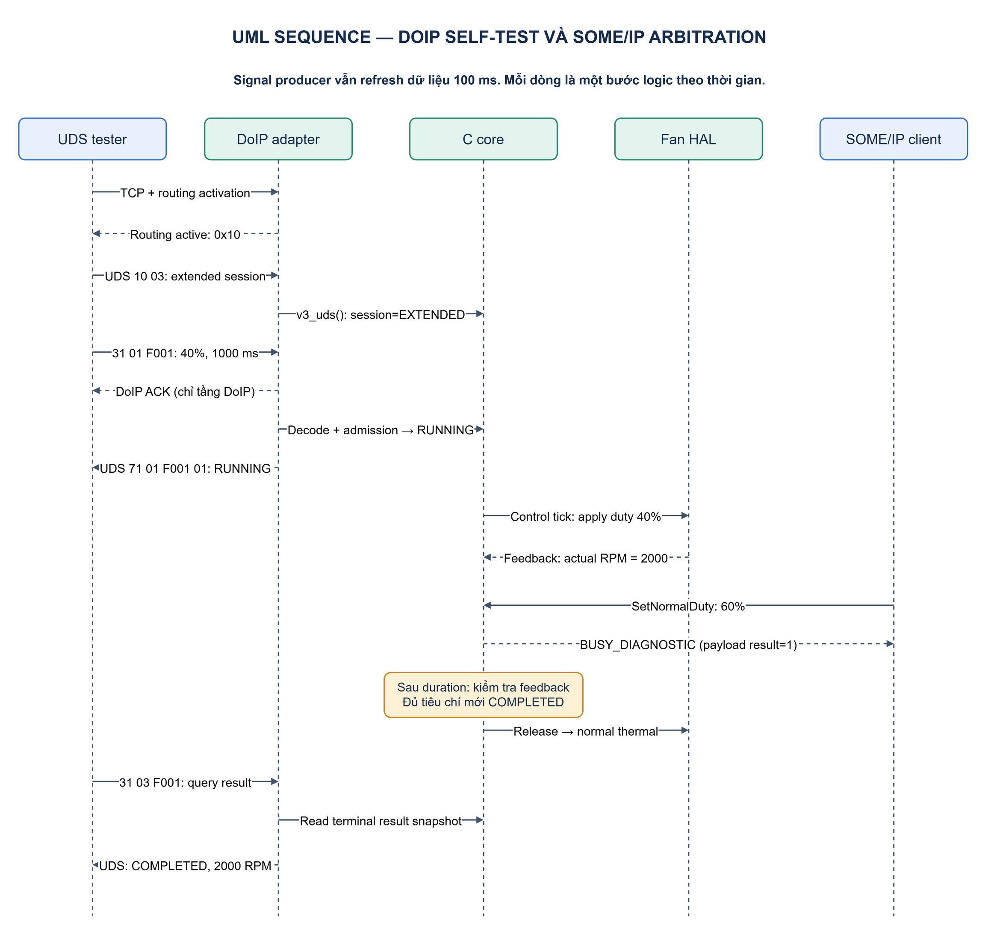
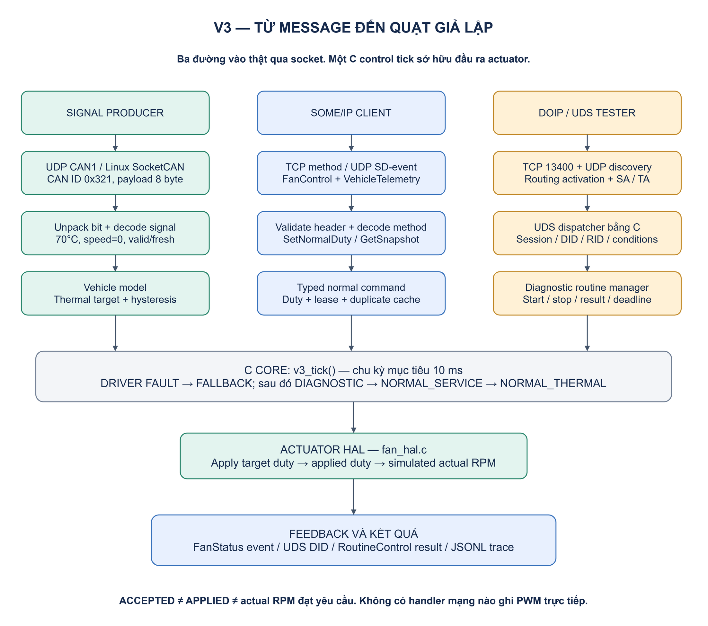
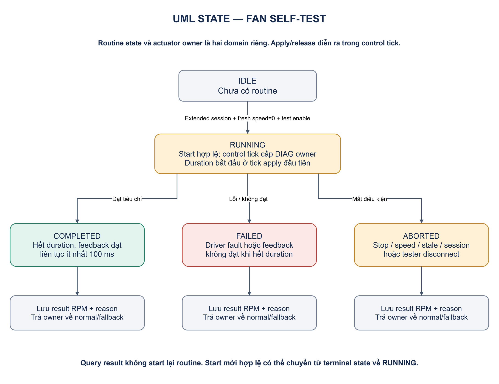

# Từ message trong xe đến actuator — DoIP, UDS, SOME/IP và AUTOSAR

**Phiên bản:** 1.1 · **Cập nhật:** 14/11/2026 · **Trạng thái:** có runtime V3 cho signal, DoIP/UDS, SOME/IP và fan simulator; xem [hướng dẫn chạy và phạm vi đã triển khai](05-v3-running-lab.md).

Tài liệu này trả lời câu hỏi: **một ECU nhận byte từ mạng, tách message, hiểu signal/lệnh rồi điều khiển một actuator như thế nào?** Ví dụ xuyên suốt là ECU điều khiển **quạt giả lập**. Mọi ID, layout signal, thời gian, điều kiện và luật điều khiển có nhãn lab đều do project định nghĩa, không phải thông số của xe/OEM.

Đọc cùng [thiết kế và spec V1/V2](../PROJECT_DESIGN_SPEC.md). Phần cơ bản hiện có vẫn là C TCP client/server; tài liệu này mở rộng đích học tập thành **Virtual ECU Diagnostic & Actuation Lab**, gọi là **V3**.

## Mục lục

1. [Ba luồng thông tin cần phân biệt](#1-ba-luồng-thông-tin-cần-phân-biệt)
2. [Signal, message, PDU, frame và schema](#2-signal-message-pdu-frame-và-schema)
3. [DoIP và UDS làm việc cùng nhau thế nào?](#3-doip-và-uds-làm-việc-cùng-nhau-thế-nào)
4. [Sơ đồ tổng thể phiên bản nâng cao](#4-sơ-đồ-tổng-thể-phiên-bản-nâng-cao)
5. [Pipeline nhận → unpack → decode → actuator](#5-pipeline-nhận--unpack--decode--actuator)
6. [Ví dụ A: signal nhiệt độ làm quạt chạy](#6-ví-dụ-a-signal-nhiệt-độ-làm-quạt-chạy)
7. [Ví dụ B: DoIP/UDS chạy bài kiểm tra quạt](#7-ví-dụ-b-doipuds-chạy-bài-kiểm-tra-quạt)
8. [Khi SOME/IP và DoIP cùng điều khiển một ECU](#8-khi-someip-và-doip-cùng-điều-khiển-một-ecu)
9. [Đặt pipeline vào AUTOSAR Classic và Adaptive](#9-đặt-pipeline-vào-autosar-classic-và-adaptive)
10. [Spec V3: module, state, timing và lỗi](#10-spec-v3-module-state-timing-và-lỗi)
11. [Test plan và bằng chứng cần có](#11-test-plan-và-bằng-chứng-cần-có)
12. [Thứ tự học sau phần cơ bản](#12-thứ-tự-học-sau-phần-cơ-bản)
13. [Câu hỏi tự kiểm tra và nguồn đọc](#13-câu-hỏi-tự-kiểm-tra-và-nguồn-đọc)

## 1. Ba luồng thông tin cần phân biệt

| Luồng | Câu hỏi nghiệp vụ | Cách biểu diễn trong bài học |
| --- | --- | --- |
| Dữ liệu vận hành | “Nhiệt độ hiện tại là bao nhiêu?”, “Xe đang đứng yên không?” | Signal được đóng trong CAN message hoặc data của SOME/IP service |
| Service communication | “Đọc snapshot”, “Subscribe trạng thái”, “Yêu cầu duty mới” | SOME/IP method/event với interface và payload xác định |
| Chẩn đoán | “Đọc dữ liệu ECU”, “Chạy self-test quạt”, “Lấy kết quả routine” | UDS request/response được vận chuyển bằng DoIP |

Một đại lượng như nhiệt độ có thể xuất hiện ở cả ba luồng: signal vận hành, trường của event SOME/IP và dữ liệu đọc qua DID. Khi thiết kế project, ba đường đó nên đọc **cùng model dữ liệu**, thay vì tự duy trì ba bản giá trị khác nhau.

DoIP là lớp chẩn đoán trên IP, thường chở thông điệp UDS. SOME/IP là giao tiếp hướng service; không phải lớp bắt buộc để DoIP hoạt động. Chúng có thể cùng dùng Ethernet/IP của ECU. [AUTOSAR DoIP](https://www.autosar.org/fileadmin/standards/R24-11/CP/AUTOSAR_CP_SWS_DiagnosticOverIP.pdf), [SOME/IP introduction của COVESA](https://github.com/COVESA/vsomeip/wiki/vsomeip-in-10-minutes)

```text
Normal operation:  signal / SOME/IP → application control → actuator
Diagnostics:       UDS over DoIP    → diagnostic handler → application control → actuator
                                                          ▲
                                                cùng policy/arbitration
```

Không cần bọc SOME/IP trong DoIP để “kết hợp”. Ở bài lab này, hai protocol đi vào hai adapter riêng rồi gặp nhau ở tầng nghiệp vụ.

## 2. Signal, message, PDU, frame và schema

### 2.1. Từ giá trị vật lý đến byte

| Khái niệm | Ví dụ trong lab | Điều cần nhớ |
| --- | --- | --- |
| Giá trị vật lý | Nhiệt độ 70.0°C | Có đơn vị và ngữ nghĩa |
| Signal | `CoolantTemperature` | Có kiểu, bit layout, scale, offset, validity |
| Raw value | 1100 | Số nguyên theo encoding đã thống nhất |
| Message | CAN ID `0x321`, payload 8 byte | Gom nhiều signal theo layout lab |
| PDU | Đơn vị dữ liệu tại một ranh giới protocol/module | Thuật ngữ phụ thuộc tầng; không đồng nhất với mọi frame vật lý |
| Frame/packet | CAN frame, Ethernet frame, IP packet | Mỗi tầng có header/quy tắc riêng |
| Service payload | Struct dữ liệu được serialize cho SOME/IP | Schema có thể khác layout CAN dù cùng giá trị vật lý |
| Diagnostic data | UDS SID + DID/RID + tham số | Cần biết contract của dịch vụ chẩn đoán |

Không suy ra tên signal từ byte hoặc chỉ từ CAN ID. Receiver cần schema/configuration. Trong workflow thực tế có thể gặp DBC cho CAN, ARXML cho mô tả AUTOSAR và ODX cho diagnostic data; chúng không thay thế lẫn nhau một cách trực tiếp.

### 2.2. “Unpack” và “decode” khác nhau ở đâu?

Trong tài liệu này, dùng quy ước để dễ học:

```text
Extract/unpack: byte/bit → raw integer
Decode/interpret: raw integer → giá trị có đơn vị / enum / command có ý nghĩa
Validate: kiểm tra length, range, validity, freshness, state và quyền điều khiển
Execute: thay đổi state/đầu ra theo luật nghiệp vụ
```

Ví dụ lab: lấy 12 bit ra `raw = 1100` là unpack; tính `1100 × 0.1 − 40 = 70°C` là decode. Trong tài liệu/thư viện khác, từ “decode” có thể bao gồm cả hai bước; hãy nhìn chính xác function làm gì.

### 2.3. Contract tối thiểu của một signal

Bạn cần chốt: message/PDU nào chứa nó, vị trí bit, số bit, endian, signedness, scale/offset, đơn vị, miền hợp lệ, invalid pattern, chu kỳ gửi và timeout. Nếu có counter/checksum/E2E thì phải có thuật toán và quy tắc xử lý riêng.

CAN CRC ở tầng bus không tự thay một cơ chế kiểm tra freshness/sequence của ứng dụng. Header length cũng không chứng minh nội dung cảm biến đúng. Bản lab sẽ giữ riêng `value`, `quality`, `timestamp` và `source` để ứng dụng biết giá trị có dùng được không.

## 3. DoIP và UDS làm việc cùng nhau thế nào?

### 3.1. Phân vai giữa các tầng

```text
UDS:         yêu cầu chẩn đoán có ý nghĩa gì?
             SID nào, DID/RID nào, session nào, kết quả/lỗi nào?
                    │
DoIP:        đóng gói và định tuyến thông điệp diagnostic tới logical address nào?
                    │
TCP/IP:      kết nối và vận chuyển byte qua mạng
                    │
Ethernet:    frame đi qua đường truyền
```

Trong lab đề xuất: tester tìm node bằng UDP, mở TCP đến port 13400, thực hiện routing activation rồi gửi diagnostic message. IP address đưa bạn đến DoIP entity; logical address xác định đối tượng diagnostic. Một entity có thể là ECU hoặc cổng gateway đến các ECU khác. [doipclient: connection và addressing](https://python-doipclient.readthedocs.io/en/latest/)

### 3.2. Luồng kết nối và chẩn đoán

[](images/v3-diagnostic-sequence.png)

[Source draw.io](diagrams/v3-diagnostic-sequence.drawio).

Sơ đồ giản lược phân trách nhiệm; thứ tự ACK/response trên thực tế còn phụ thuộc implementation và timing. **Routing activation thành công chưa cấp quyền chạy mọi diagnostic service.** Session, authorization và điều kiện thực thi được kiểm tra ở các lớp liên quan.

### 3.3. Ba mức phản hồi phải đọc riêng

| Phản hồi | Điều nó cho biết | Điều chưa được chứng minh |
| --- | --- | --- |
| TCP ACK | TCP peer xác nhận byte ở mức transport | UDS đã xử lý request |
| DoIP diagnostic positive ACK | Diagnostic message được chấp nhận ở tầng DoIP theo contract | Routine hoặc actuator đã hoàn tất |
| UDS positive response | Dịch vụ UDS chấp nhận/hoàn thành bước theo ngữ nghĩa service | Với start routine bất đồng bộ: actuator đã đạt trạng thái vật lý cuối |
| Application feedback/routine result | Trạng thái thực thi do ECU báo | Phải đọc field/status và chất lượng feedback cụ thể |

DoIP diagnostic ACK/NACK và UDS payload là các message khác nhau. [doipclient message definitions](https://python-doipclient.readthedocs.io/en/latest/messages.html)

### 3.4. DoIP generic header và payload

```text
Offset 0: protocol version          1 byte
Offset 1: inverse protocol version  1 byte
Offset 2: payload type              2 byte, big-endian
Offset 4: payload length            4 byte, big-endian
Offset 8: payload                   payload length byte
```

Với diagnostic message, payload bắt đầu bằng source logical address 2 byte, target logical address 2 byte, sau đó diagnostic user data, ví dụ UDS. Receiver TCP phải reassemble header và body; một lần `recv()` không đồng nghĩa một DoIP message. [AUTOSAR DoIP, §7.3](https://www.autosar.org/fileadmin/standards/R24-11/CP/AUTOSAR_CP_SWS_DiagnosticOverIP.pdf)

Các payload type dùng để đọc capture:

| Type | Ý nghĩa |
| --- | --- |
| `0x0001` / `0x0004` | Vehicle identification request / response-announcement |
| `0x0005` / `0x0006` | Routing activation request / response |
| `0x0007` / `0x0008` | Alive check request / response |
| `0x8001` | Diagnostic message |
| `0x8002` / `0x8003` | Diagnostic positive / negative ACK |

Nguồn định danh message: [AUTOSAR Diagnostics, bảng supportedDoIpMessageTypes](https://www.autosar.org/fileadmin/standards/R24-11/AP/AUTOSAR_AP_SWS_Diagnostics.pdf).

### 3.5. UDS service nên học theo thứ tự

| SID | Service | Cách dùng trong lab |
| --- | --- | --- |
| `0x10` | DiagnosticSessionControl | Chuyển default/extended session |
| `0x22` | ReadDataByIdentifier | Đọc nhiệt độ, fan status theo DID lab |
| `0x3E` | TesterPresent | Duy trì session theo cấu hình |
| `0x31` | RoutineControl | Start/stop/query kết quả self-test |
| `0x2F` | InputOutputControlByIdentifier | Nhánh tiếp theo: điều khiển I/O tạm thời theo DID |

Các field và cách tạo request/đọc response tham khảo [udsoncan service definitions](https://udsoncan.readthedocs.io/en/latest/udsoncan/services.html). DID/RID, điều kiện và payload record phải được định nghĩa cho ECU cụ thể.

Đừng gộp TCP keepalive, DoIP AliveCheck và UDS TesterPresent thành một timer: chúng phục vụ những lớp/state khác nhau. Ở lab cần log riêng socket state, routing state và diagnostic session state.

## 4. Sơ đồ tổng thể phiên bản nâng cao

### 4.1. Ba đầu vào, một actuator owner

[](images/v3-workflow.png)

[Source draw.io](diagrams/v3-workflow.drawio).

Không cho network callback ghi PWM trực tiếp. Callback tạo dữ liệu/lệnh đã kiểm tra; một control task sở hữu đầu ra và quyết định cập nhật actuator. Quy tắc này là **thiết kế của project**, giúp tránh hai nguồn ghi đè nhau.

### 4.2. Topology V3 đề xuất

```text
eln-tester                     eln-vehicle                     eln-control
10.23.0.10                     10.23.0.11                     10.23.0.12
DoIP/UDS tool                  signal producer                virtual ECU
                              SOME/IP client                 DoIP endpoint
                                                            SOME/IP service
           └──────────────── Linux bridge lab ───────────────────┘
                                                               │
                                                        fan simulator
```

Đây là topology tương lai, chưa có trong `scripts/lab.sh`. Giai đoạn đầu chạy tester và ECU trên loopback; thêm namespace sau khi codec/state machine đã có test. vcan thuộc network namespace nên phải đặt producer và receiver cùng môi trường có liên kết CAN phù hợp, hoặc dùng adapter chuyển tiếp được định nghĩa rõ; không giả định bridge Ethernet truyền được CAN frame.

## 5. Pipeline nhận → unpack → decode → actuator

### 5.1. Các bước xử lý có trách nhiệm riêng

| Bước | Input → output | Kiểm tra/thiết kế cần có |
| --- | --- | --- |
| 1. Receive | Socket/CAN frame → bytes | EOF/error, nguồn, giới hạn buffer |
| 2. Reassemble | TCP byte chunks → complete protocol message | Header length, max size, frame deadline |
| 3. Validate envelope | Message → accepted protocol envelope | Version, type, address, routing/config |
| 4. Unpack | Byte/bit fields → raw values | Offset, bit length, endian, signedness |
| 5. Decode | Raw values → typed model/command | Scale, offset, enum, invalid representation |
| 6. Validate semantics | Model/command → valid update hoặc reject | Range, freshness, sequence, session, operating state |
| 7. Route/dispatch | Typed input → đúng handler | CAN mapping, method ID, UDS SID/DID/RID |
| 8. Arbitrate | Các request → một owner và target | Normal/service/diagnostic, lease, priority |
| 9. Execute | Target → actuator abstraction | Bounds, timing, state transition, lỗi driver |
| 10. Observe/respond | Feedback → result/event/UDS response | Accepted khác completed; fault/stale/timeout |

Đây là decomposition để học, không phải thứ tự cố định cho mọi stack. Dispatch sơ bộ thường phải biết SID/message type trước khi decode record; việc validate diễn ra nhiều lần ở từng tầng. Không dispatch tới handler nghiệp vụ khi record của handler chưa được kiểm tra.

### 5.2. Hàm và dữ liệu nội bộ nên thiết kế

```text
receive_bytes()         -> RxChunk
assemble_message()      -> ProtocolEnvelope
parse_envelope()        -> DiagnosticRequest / ServiceRequest / SignalPdu
decode_record()         -> TypedCommand / SignalSample
validate_context()      -> ValidatedInput hoặc Error
enqueue_validated()     -> bounded queue / latest-value store
control_tick()          -> arbitration + target
actuator_apply()        -> AppliedOutput hoặc DriverError
read_feedback()         -> ObservedState
build_response()        -> encoded response/status
```

`TypedCommand` của lab nên mang `origin`, `connection/session context`, `command_id`, `received_at`, `deadline`, `target`, `requested_owner`. Sau khi decode, logic điều khiển không cần biết target ban đầu nằm ở byte thứ mấy của packet.

Validation lúc nhận chưa thay validation lúc execute: trong khi command nằm trong queue, session có thể hết, speed có thể đổi hoặc một owner khác đã được cấp. Control task phải kiểm tra lại context/deadline và cấp owner nhất quán trước khi apply. Callback có thể báo dữ liệu mới sẵn sàng, còn runnable/control task chạy theo scheduling; không giả định mỗi packet nhận được lập tức tạo một thao tác phần cứng.

### 5.3. Không block network handler bằng chuyển động actuator

Routine một giây không có nghĩa network thread ngủ một giây. Handler validate và đăng ký routine; control task tiếp tục theo tick. Handler phản hồi theo contract bất đồng bộ; tester query trạng thái hoặc nhận event cập nhật. Nếu dịch vụ UDS chưa thể trả lời đúng thời gian xử lý, cơ chế response pending có ý nghĩa riêng; không dùng nó thay tùy tiện cho trạng thái “quạt đang chạy”.

## 6. Ví dụ A: signal nhiệt độ làm quạt chạy

### 6.1. Message layout do lab định nghĩa

**CAN ID:** `0x321` standard · **Payload:** đúng 8 byte · **Chu kỳ mục tiêu:** 100 ms. Codec và producer đã có trong `advanced/`.

| Vị trí | Field | Encoding lab |
| --- | --- | --- |
| Byte 0 + low nibble byte 1 | `temperature_raw` | Unsigned 12 bit, little-endian; `T = raw × 0.1 − 40°C` |
| High nibble byte 1 | Reserved | Phải bằng 0 |
| Byte 2–3 | `vehicle_speed_raw` | Unsigned 16 bit little-endian; `speed = raw × 0.01 km/h` |
| Byte 4 | `counter` | uint8 tăng modulo 256 |
| Byte 5, bit 0 | `valid` | 1: sample hợp lệ; các bit khác bằng 0 |
| Byte 6–7 | Reserved | Bằng 0 |

Lab định nghĩa `temperature_raw = 0xFFF` là invalid, speed `0xFFFF` là invalid. Sample mới chỉ cập nhật model hợp lệ khi reserved/validity/range đúng và counter được xử lý theo policy. Counter để đo sequence, không phải AUTOSAR E2E profile.

Golden vector:

```text
CAN ID 0x321, length 8
Payload: 4c 04 00 00 01 01 00 00

temperature_raw = 0x44c = 1100 -> 70.0°C
speed_raw       = 0           -> 0.00 km/h
counter         = 1
valid           = 1
```

Ví dụ unpack dạng pseudocode, chỉ đọc sau khi kiểm tra length:

```c
temp_raw  = p[0] | ((p[1] & 0x0f) << 8);
speed_raw = p[2] | (p[3] << 8);
temp_c    = temp_raw * 0.1 - 40.0;
speed_kph = speed_raw * 0.01;
```

Đây là layout riêng, không phải công thức tổng quát cho mọi signal trong DBC. Khi học Motorola/non-byte-aligned bit layout phải kiểm tra quy ước start bit của tool/file thay vì chỉ đảo thứ tự byte.

### 6.2. Từ sample 70°C đến target 40%

Luật normal control của simulator:

```text
Lần đầu có sample valid, fresh:
  T >= 60°C  -> target = 40%
  T < 60°C   -> target = 0%

Các lần sau:
  T >= 60°C  -> target = 40%
  T <= 55°C  -> target = 0%
  55 < T < 60°C -> giữ target normal trước đó
```

Khoảng 55–60°C là hysteresis để target không đổi liên tục quanh một ngưỡng. Sample quá 300 ms hoặc invalid làm normal input không dùng được; simulator chọn fallback 0%. **Fallback 0% chỉ là lựa chọn cho quạt ảo của lab**, không được suy ra đó là hành vi phù hợp cho hệ thống làm mát thật.

```text
4c 04 ... → raw 1100 → 70°C → valid/fresh → normal controller
                                                   │
                                  không có DIAG owner đang giữ
                                                   │
                                       target 40% → HAL → simulator
                                                   │
                                applied duty + simulated RPM → feedback
```

### 6.3. Target, applied output và actual state

`target_duty = 40%` là yêu cầu. `applied_duty = 40%` là giá trị tầng actuator đã áp dụng. `actual_rpm` là phản hồi quan sát từ simulator hoặc sensor; nó có thể khác mong đợi do fault hoặc động học.

Lab chọn model đơn giản: `expected_rpm = duty_percent × 50`, nên 40% tương ứng 2000 RPM kỳ vọng. Model này là giả lập để test luồng dữ liệu, không phải mô hình vật lý của quạt thật. Fault injection có thể giữ `actual_rpm = 0` dù applied duty khác 0.

Nếu map sang AUTOSAR PWM Driver sau này, duty API dùng thang `0x0000 = 0%`, `0x8000 = 100%`; không truyền trực tiếp số 40 và hiểu là 40%. [AUTOSAR PWM Driver, §7.4](https://www.autosar.org/fileadmin/standards/R24-11/CP/AUTOSAR_CP_SWS_PWMDriver.pdf)

## 7. Ví dụ B: DoIP/UDS chạy bài kiểm tra quạt

### 7.1. Diagnostic contract của lab

| Thuộc tính | Giá trị đề xuất |
| --- | --- |
| DoIP endpoint | Virtual ECU `10.23.0.12`, TCP/UDP 13400 |
| Tester logical address | `0x0E00` |
| ECU logical address | `0x0001` |
| Protocol profile của bài byte bên dưới | Version `0x03`, inverse `0xFC`; cấu hình rõ ở cả hai đầu |
| Routine | `FanSelfTest`, RID `0xF001` do lab chọn |
| Start input | Duty uint16 BE, đơn vị 0.01%; duration uint16 BE, đơn vị ms |
| Duty/duration cho phép | 0–10000 tương ứng 0–100%; 100–2000 ms |
| Điều kiện start | Extended session, `test_enable=true`, speed valid/fresh bằng 0, không actuator fault |
| Kết quả chạy | State và actual RPM; query qua RequestRoutineResults |

Version `0x02` và `0x03` thuộc những revision khác nhau; tool có thể mặc định `0x02`. Vì vậy không hard-code inverse `0xFD` trong khi cấu hình protocol `0x03`. [doipclient protocol_version](https://python-doipclient.readthedocs.io/en/latest/)

`test_enable` là cờ cấu hình simulator để học admission policy; không thay UDS authentication/security và không giả lập một thuật toán unlock ECU thật. Profile này là subset phục vụ lab, chưa phải cam kết conform ISO/AUTOSAR đầy đủ.

Trước routine, học đường read-only qua hai DID do lab định nghĩa:

| DID lab | Record sau DID trong positive response `0x62` |
| --- | --- |
| `0xF200` | Temperature: `temp_centi_c:int16`, `quality:uint8`, `age_ms:uint16`, big-endian, tổng 5 byte |
| `0xF201` | FanStatus: record 16 byte như §8.3; thao tác đọc không đổi actuator |

`quality`: 0 VALID, 1 INVALID/NO_DATA, 2 STALE. Age tính trên clock ECU, saturate ở 65535 ms; NO_DATA dùng age 65535 và temperature 0 nhưng không được coi là giá trị valid. Ví dụ request `22 f2 00`, response cho sample 70°C vừa cập nhật: `62 f2 00 1b 58 00 00 00`. Khi implement phải chốt snapshot consistency để các field thuộc cùng một lần đọc.

Session DEFAULT dùng subfunction `0x01`, EXTENDED dùng `0x03`; ví dụ request chuyển extended là `10 03`. Session này chỉ thay diagnostic context, không tự cấp DIAGNOSTIC actuator owner; việc cấp owner xảy ra sau admission của routine hợp lệ.

### 7.2. Request từ tester

Ví dụ: start self-test duty **40%**, thời gian **1000 ms**. Giả định routing activation và extended session đã thành công.

```text
UDS request:
31 01 f0 01 0f a0 03 e8
│  │  │     │     └─ duration = 0x03e8 = 1000 ms
│  │  │     └─────── duty_raw = 0x0fa0 = 4000 = 40.00%
│  │  └───────────── RID = 0xf001 (lab)
│  └──────────────── subfunction 0x01 = startRoutine
└─────────────────── SID 0x31 = RoutineControl
```

DoIP envelope đề xuất cho cùng request:

```text
03 fc 80 01 00 00 00 0c  0e 00 00 01  31 01 f0 01 0f a0 03 e8
└──── header 8 byte ───┘  └ SA / TA ┘  └──── UDS 8 byte ──────┘

payload_type   = 0x8001
payload_length = 12 = 2 byte SA + 2 byte TA + 8 byte UDS
total_length   = 20 byte, chưa tính TCP/IP/Ethernet
```

Không thêm header length 4 byte V1 hoặc header SOME/IP quanh message này. Port, logical address, SID và RID là các định danh ở những tầng khác nhau.

### 7.3. ECU xử lý request theo từng lớp

1. **Socket layer:** nhận TCP bytes; có thể chỉ nhận 3 byte đầu ở lần đầu tiên.
2. **DoIP assembler:** ghép đủ 8 byte header; kiểm tra version/inverse, type, giới hạn length; chờ đủ body với deadline.
3. **DoIP routing:** kiểm tra TCP connection đã active, SA khớp tester gắn với connection và TA có trong mapping.
4. **UDS dispatcher:** đọc SID `0x31`; kiểm tra length và subfunction trước khi đọc record.
5. **Routine decoder:** đọc RID `0xF001`, duty raw 4000, duration 1000; biến thành `FanSelfTestRequest`.
6. **Admission policy:** kiểm tra extended session, test mode, speed/freshness, fault và routine hiện tại.
7. **Routine manager:** đăng ký state RUNNING, deadline dừng và diagnostic ownership.
8. **Control task:** arbiter chọn DIAG target 40%; HAL áp dụng duty; simulator tạo actual RPM.
9. **Response:** trả start response theo contract; kết quả cuối được lấy bằng query hoặc status đã định nghĩa.
10. **Finish/release:** hết thời gian thì trả actuator owner về normal hoặc fallback; lưu routine result.

### 7.4. Start response không có nghĩa routine đã chạy xong

Lab quy định routine status byte:

| Giá trị lab | State |
| --- | --- |
| `0x00` | IDLE |
| `0x01` | RUNNING |
| `0x02` | COMPLETED |
| `0x03` | ABORTED |
| `0x04` | FAILED |

Start response thành công trong ví dụ:

```text
71 01 f0 01 01
│  │  │     └─ routineStatusRecord: RUNNING theo lab
│  │  └─────── RID echo
│  └────────── subfunction echo
└───────────── positive response của RoutineControl
```

Query: `31 03 f0 01`. Response lab: `71 03 f0 01 SS RR RR`, trong đó `SS` là state, `RR RR` là actual RPM snapshot uint16 BE. Stop: `31 02 f0 01`; response lab `71 02 f0 01 03` khi routine đang chạy được chuyển sang ABORTED. Khi không có routine phù hợp, handler trả lỗi sequence theo contract.

Phần `routineStatusRecord` là dữ liệu ứng dụng do lab định nghĩa; không phải mọi ECU đều có status layout này. Format start/stop/query tham khảo [RoutineControl API](https://udsoncan.readthedocs.io/en/latest/udsoncan/services.html#routinecontrol-0x31).

### 7.5. Ví dụ bị từ chối ở đúng tầng

| Lỗi | Tầng xử lý | Hành vi lab |
| --- | --- | --- |
| Version/inverse sai | DoIP header parser | Protocol reject theo profile; không gọi UDS |
| Routing chưa active hoặc TA không biết | DoIP routing | DoIP reject phù hợp; không ghi actuator |
| UDS record thiếu byte | UDS/routine parser | Negative response format/length |
| Duty > 10000 hoặc duration ngoài khoảng | Routine validation | Negative response parameter/range |
| Speed khác 0 hoặc stale, test mode tắt | Admission policy | Ví dụ `7f 31 22`: conditionsNotCorrect |
| Routine xung đột/sequence sai | Routine manager | Negative response phù hợp với state/service contract |
| HAL lỗi sau khi đã start | Execution | Routine FAILED; feedback lỗi; release owner theo policy |

Negative response và việc thực thi callback/routine phải tuân theo cấu hình diagnostic; DCM có trách nhiệm xử lý service/session/conditions cùng application integration. [AUTOSAR DCM](https://www.autosar.org/fileadmin/standards/R24-11/CP/AUTOSAR_CP_SWS_DiagnosticCommunicationManager.pdf)

### 7.6. Trạng thái routine bất đồng bộ

[](images/v3-routine-states.png)

[Source draw.io](diagrams/v3-routine-states.drawio).

Lab định nghĩa COMPLETED khi duty được áp dụng và feedback đạt dải `expected_rpm ± 10%` liên tục ít nhất 100 ms trong cửa sổ chạy. Sau khi kết thúc, giữ result snapshot để query; đó có thể là RPM lúc hoàn tất, khác RPM hiện tại sau khi normal control lấy lại owner. Criterion này chỉ áp dụng simulator.

## 8. Khi SOME/IP và DoIP cùng điều khiển một ECU

### 8.1. Interface SOME/IP bổ sung

V2 đã đề xuất `VehicleTelemetryService`. V3 giữ service đó để quan sát và đề xuất thêm **`FanControlService`** riêng để điều khiển simulator; không sửa âm thầm ý nghĩa telemetry service.

| Contract V3 do lab chọn | Giá trị |
| --- | --- |
| Service / instance / version | `0x1235 / 0x0001 / 1.0` |
| Method | `SetNormalDuty`, ID `0x0001` |
| Request payload | `command_id:uint32`, `duty_raw:uint16`, `lease_ms:uint16`; big-endian, tổng 8 byte |
| Request range | duty 0–10000; lease 100–2000 ms |
| Response payload | `command_id:uint32`, `result:uint8`, `reserved:uint8=0`; tổng 6 byte |
| Result enum của lab | 0 ACCEPTED; 1 BUSY_DIAGNOSTIC; 2 INVALID; 3 FAULT |
| Status event | `FanStatus`, ID `0x8001`, eventgroup `0x0001` |
| Provider endpoint đề xuất | TCP 30511 cho method, UDP 30512 cho event |

Kết quả nghiệp vụ BUSY_DIAGNOSTIC nằm trong payload response được định nghĩa; không tự phát minh một mã SOME/IP Return Code rồi coi là chuẩn. ACCEPTED nghĩa request được nhận vào state của controller, chưa xác nhận actual RPM.

### 8.2. Một luật arbitration cụ thể

```text
Nếu actuator fault hoặc input/context bắt buộc invalid:
    owner = FALLBACK, duty = 0% trong simulator
Ngược lại, nếu diagnostic routine hợp lệ đang giữ quyền:
    owner = DIAGNOSTIC
Ngược lại, nếu SOME/IP normal command còn lease và hợp lệ:
    owner = NORMAL_SERVICE
Ngược lại, nếu thermal input còn fresh:
    owner = NORMAL_THERMAL
Ngược lại:
    owner = FALLBACK
```

Trong DIAGNOSTIC mode, `SetNormalDuty` trả BUSY_DIAGNOSTIC và không tạo pending command để bất ngờ chạy sau self-test. Khi cấp DIAG owner, hủy normal service lease cũ. Thermal model vẫn cập nhật để có dữ liệu mới khi trả owner.

Session hết hạn, stop request, routine duration hết, speed không còn bằng 0 hoặc fault phát sinh đều cần đưa routine ra khỏi RUNNING theo policy. DoIP TCP mất kết nối chỉ được xử lý sau khi ECU **phát hiện** closure/liveness timeout; không giả định mất dây mạng được phát hiện tức thì. Actuator local duration/deadline vẫn giới hạn thời gian chạy.

### 8.3. Event feedback của lab

`FanStatus` đề xuất payload 16 byte, big-endian:

```text
status_sequence:uint32
last_service_command_id:uint32
target_duty_raw:uint16
applied_duty_raw:uint16
actual_rpm:uint16
owner:uint8
routine_state:uint8
```

`owner`: 0 FALLBACK, 1 NORMAL_THERMAL, 2 NORMAL_SERVICE, 3 DIAGNOSTIC. Đây là state data, không phải cờ chứng minh lệnh thành công. Routine identity dùng RID + diagnostic context; không đồng nhất nó với `last_service_command_id` của service command.

Spec ý tưởng đặt mục tiêu event định kỳ và khi state thay đổi. Runtime hiện gửi initial event sau subscribe và sau đó định kỳ 100 ms; trace ghi thay đổi state ở control tick. Cache 16 entry/cửa sổ 10 s đã được triển khai, key gồm client identity và command_id trong một runtime epoch; cùng ID/payload không kéo dài lease, payload khác bị từ chối. Chi tiết giới hạn eviction/restart xem [implementation](05-v3-running-lab.md).

## 9. Đặt pipeline vào AUTOSAR Classic và Adaptive

### 9.1. Classic: đường signal CAN

```text
CAN bus
  → CAN Driver → CanIf → PduR → COM
  → RTE → application SWC/runnable
  → actuator abstraction / IoHwAb theo thiết kế
  → MCAL driver → phần cứng
```

Đây là sơ đồ trách nhiệm giản lược, bỏ qua nhiều module/state quản lý. COM xử lý signal trong I-PDU, gồm unpacking và cơ chế timeout/config liên quan; nó không phải nơi chứa mọi thuật toán điều khiển quạt. Scale/đổi đơn vị có thể thuộc data conversion/transformer hoặc application theo thiết kế, không mặc định COM tự tính mọi giá trị vật lý. [AUTOSAR COM](https://www.autosar.org/fileadmin/standards/R24-11/CP/AUTOSAR_CP_SWS_COM.pdf)

PduR định tuyến PDU giữa module theo cấu hình; việc chuyển PDU không tự biến thành quyết định “quạt chạy 40%”. [AUTOSAR PDU Router](https://www.autosar.org/fileadmin/standards/R24-11/CP/AUTOSAR_CP_SWS_PDURouter.pdf)

### 9.2. Classic: đường DoIP/UDS

```text
Ethernet Driver → EthIf → TcpIp → SoAd → DoIP
  → PduR → DCM
  → application integration/RTE/callback theo cấu hình
  → routine/control logic → actuator abstraction → driver
```

DoIP xử lý giao thức/routing diagnostic trên IP. DCM dispatch service và tích hợp routine/data access với application theo cấu hình. Application handler vẫn quyết định cách đọc cảm biến hoặc điều khiển actuator được phép. [AUTOSAR DoIP](https://www.autosar.org/fileadmin/standards/R24-11/CP/AUTOSAR_CP_SWS_DiagnosticOverIP.pdf), [AUTOSAR DCM](https://www.autosar.org/fileadmin/standards/R24-11/CP/AUTOSAR_CP_SWS_DiagnosticCommunicationManager.pdf)

Một DoIP gateway cũng có thể đưa diagnostic request sang ECU CAN qua đường transport khác. Trong trường hợp đó, ECU ở phía sau không nhất thiết có DoIP stack. Mapping logical address, transport, response timeout và nguồn/đích phải được cấu hình rõ; V3 đầu tiên chỉ có ECU đích cục bộ để giảm số biến.

### 9.3. Adaptive và Linux service application

```text
Ethernet / Linux IP stack
  → middleware binding
  → service proxy/skeleton
  → application controller
  → actuator abstraction / kết nối sang ECU actuator
```

AUTOSAR Adaptive Communication Management có mô hình service/proxy/skeleton; binding cụ thể phụ thuộc triển khai. [AUTOSAR Adaptive Communication Management](https://www.autosar.org/fileadmin/standards/R24-11/AP/AUTOSAR_AP_SWS_CommunicationManagement.pdf)

`vsomeip` trên Ubuntu giúp học SOME/IP và SD, nhưng không tự biến Linux app thành toàn bộ AUTOSAR Adaptive Platform hoặc cung cấp đầy đủ `ara::com`. Bản V3 Linux mô phỏng trách nhiệm các lớp để học; khi chuyển sang stack AUTOSAR thật cần mapping sang API/generated configuration của stack đó. [COVESA vsomeip overview](https://github.com/COVESA/vsomeip)

### 9.4. Bảng mapping cho người học

| Module lab trên Linux | Trách nhiệm tương ứng để tìm hiểu AUTOSAR |
| --- | --- |
| `doip_transport`, `doip_router` | DoIP/SoAd/TcpIp ở mức nhiệm vụ, không cùng API |
| `uds_dispatcher`, `diag_session` | DCM/diagnostic stack |
| `signal_codec`, `vehicle_model` | Signal mapping, COM/data access và application model |
| `someip_adapter` | SOME/IP binding; proxy/skeleton trong kiến trúc service |
| `fan_controller`, `routine_manager` | Application SWC/runnable hoặc Adaptive application |
| `actuator_hal`, `fan_simulator` | Actuator abstraction, driver/plant boundary |

Mục tiêu là hiểu ranh giới trách nhiệm trước khi học hàng trăm API và configuration parameter.

### 9.5. Khi actuator nằm ở ECU khác

Trong xe, ứng dụng nhận service và phần cứng actuator có thể không ở cùng node. Một sơ đồ **đề xuất cho bước mở rộng**:

```text
SOME/IP request trên Ethernet
  → gateway service adapter
  → decode + policy + command mapping
  → encode CAN actuator command theo schema khác
  → CAN bus
  → actuator ECU: receive → unpack → validate → local control → PWM
  → CAN feedback
  → gateway decode → SOME/IP status/result
```

Ở đây có hai lần serialize/decode với hai contract khác nhau. Gateway phải map đơn vị, range, validity, thời hạn và command identity; không chỉ copy payload Ethernet sang CAN. Feedback từ actuator ECU là bằng chứng khác với việc gateway đã transmit CAN frame.

Một diagnostic gateway cũng có đường riêng: nhận DoIP diagnostic message, chuyển UDS tới ECU CAN qua transport diagnostic phù hợp như ISO-TP, rồi chuyển response về tester. Đây là **routing diagnostic**, khác gateway giải mã signal để tạo command ứng dụng ở sơ đồ trên. Khi triển khai, chọn rõ đang mô phỏng kiến trúc nào trước khi viết decoder.

## 10. Spec V3: module, state, timing và lỗi

### 10.1. Cấu trúc source dự kiến

```text
advanced/
  core/ecu_core.c        signal codec, model, UDS/session, routine, cache, arbiter
  core/fan_hal.c         actuator simulator port
  core.py               ctypes interface
  protocol.py           DoIP/SOME-IP/SD wire codec, framing
  ecu.py                network adapters, control loop, trace
  client.py             tester, signal producer, service/event consumers
  __main__.py           CLI, end-to-end demo
  tests/                core, protocol, network tests
```

Đây là bản phân module, không bắt buộc mỗi dòng phải là một process hoặc một file. Giai đoạn đầu một process ECU với event loop/control tick là đủ; tách thread/process chỉ khi có lý do và test concurrency.

### 10.2. State cần quản lý riêng

| State domain | Giá trị/ý nghĩa đề xuất |
| --- | --- |
| TCP | DISCONNECTED / CONNECTED |
| DoIP routing | INACTIVE / ACTIVE trên từng connection |
| UDS session | DEFAULT / EXTENDED |
| Routine | IDLE / RUNNING / COMPLETED / ABORTED / FAILED |
| Actuator owner | FALLBACK / NORMAL_THERMAL / NORMAL_SERVICE / DIAGNOSTIC |
| Sensor quality | VALID / INVALID / STALE |
| Execution | ACCEPTED / APPLIED / OBSERVED / TERMINAL |

Không dùng một biến `connected=true` để thay tất cả các domain trên. UDS session hết hạn có thể xảy ra khi TCP vẫn connected; service available vẫn có thể đi cùng dữ liệu stale.

### 10.3. Timing/resource contract do lab đề xuất

| Thuộc tính | Giá trị mục tiêu V3 |
| --- | --- |
| Control tick | 10 ms, clock monotonic |
| Normal signal period / timeout | 100 ms / stale sau 300 ms |
| Self-test duration | Request 100–2000 ms; tự stop/release khi hết duration |
| Abort phản ứng sau khi local detection | Mục tiêu tối đa 20 ms ở simulator, cần đo bằng log/test |
| UDS extended session idle timeout | Lab S3Server = 5 s; cập nhật theo diagnostic activity được quy định |
| UDS P2Server/P2*Server | Lab mục tiêu 50 ms / 5000 ms; báo qua session response theo encoding UDS khi implement |
| TesterPresent | Tool lab gửi mỗi 2 s khi cần giữ session; không dùng như keepalive actuator |
| Max DoIP payload | Lab cap 4096 byte trước allocation/receive body |
| TCP frame assembly deadline | Lab 1000 ms, độc lập UDS P2/P2* |
| Diagnostic concurrent requests | Ban đầu 1 in-flight UDS transaction, 1 actuator routine |
| Diagnostic dispatch | Bản chạy dispatch tuần tự, không có pending command queue; replay cache là 16 entry |

Đây là mục tiêu lab, chưa được đo và không phải mặc định bắt buộc của mọi ECU. Request nhận khi queue đầy phải có policy reject/backpressure rõ; tuyệt đối không âm thầm làm mất command rồi báo ACCEPTED. Với diagnostic profile cụ thể, policy trả lời/đóng kết nối phải được đối chiếu đúng layer.

### 10.4. Log đủ để lần theo một message

Ví dụ log đề xuất, các dòng có cùng `trace_id`:

```text
RX         trace=42 conn=7 bytes=20
DOIP       trace=42 type=8001 sa=0e00 ta=0001 route=ACTIVE
UDS        trace=42 sid=31 sub=01 rid=f001 session=EXTENDED
DECODE     trace=42 duty_raw=4000 duration_ms=1000
ADMISSION  trace=42 speed=0 quality=VALID test_enable=1 result=ALLOW
ARBITER    trace=42 owner=DIAGNOSTIC target_raw=4000
APPLY      trace=42 applied_raw=4000
FEEDBACK   trace=42 actual_rpm=2000
ROUTINE    trace=42 state=COMPLETED
RELEASE    trace=42 next_owner=NORMAL_THERMAL
```

Các dòng trên minh họa nhiều thời điểm, không phải cùng một lần gọi function. Log thật phải có monotonic timestamp; TCP connection, diagnostic context và routine handle cần được giữ khi xử lý bất đồng bộ. Pcap cho thấy wire bytes; log nội bộ cho thấy decision và actuator state. Cần cả hai để giải thích trọn đường đi.

## 11. Test plan và bằng chứng cần có

Bảng dưới giữ các mục tiêu nghiệm thu. Core/protocol/socket đã có test; coverage, interop và các phần Linux/hardware chưa chạy được ghi trong [báo cáo kiểm chứng](v3-validation.md).

| ID | Test | Điều phải chứng minh |
| --- | --- | --- |
| V3-A01 | Signal golden vector và encode/decode round-trip | Đúng raw, physical value, reserved và invalid pattern |
| V3-A02 | DoIP split header/body; nhiều message trong một recv | Không cắt/ghép nhầm hoặc vượt buffer/deadline |
| V3-A03 | Diagnostic trước routing activation; sai SA/TA | Không đi đến routine/actuator |
| V3-A04 | Read DID cho temp/fan status | UDS dữ liệu khớp model và codec đã định nghĩa |
| V3-A05 | Start self-test 40% / 1000 ms | Trace đầy đủ receive→decode→admission→apply→feedback→release |
| V3-A06 | Speed nonzero, stale input, sai session, record lỗi | Reject đúng tầng; output không thay đổi bởi request lỗi |
| V3-A07 | Fault trong lúc RUNNING | Routine FAILED/ABORTED theo nguyên nhân; owner được trả đúng |
| V3-A08 | Stop/query routine | Query không vô tình start lại; kết quả terminal còn đọc được |
| V3-A09 | Tester disconnect, mất traffic, session timeout | Có local detection và deadline; không treo output vô hạn |
| V3-A10 | SOME/IP command khi DIAG đang giữ quyền | BUSY_DIAGNOSTIC; không ghi output hoặc tạo pending target bất ngờ |
| V3-A11 | Command duplicate, queue đầy, command expired | Không thực thi lặp sai; bounded memory; không thực thi command quá hạn |
| V3-A12 | Counter wrap/reorder/duplicate và endian lỗi | Không coi sai sample/lệnh là giá trị hợp lệ mới |
| V3-A13 | Actuator applied nhưng feedback không đạt | Không báo COMPLETED chỉ dựa trên send/apply thành công |

Nghiệm thu V3 cần một bài demo tái hiện được gồm pcap, log trace, bảng signal/service/diagnostic mapping và state transition của actuator. Chưa cần ECU thật để chứng minh phần mềm hoạt động theo spec simulator.

## 12. Thứ tự học sau phần cơ bản

Theo ưu tiên **focus DoIP** của bạn, có thể học phần diagnostic trước khi hoàn thành toàn bộ SOME/IP V2:

| Bước | Học lý thuyết | Thực hành tương ứng |
| --- | --- | --- |
| 1 | Signal/message, endian, bit extraction, scale/offset | Decode CAN payload mẫu và unit test codec |
| 2 | Controller, state machine, target/applied/actual | Viết fan simulator với normal thermal control |
| 3 | UDS SID, DID, RID, positive/negative response | Handler trực tiếp bằng byte buffer, chưa cần DoIP |
| 4 | DoIP header, addressing, routing activation, TCP framing | Tester ↔ virtual ECU; đọc DID trước, rồi routine |
| 5 | Session/timer và xử lý bất đồng bộ | Self-test, stop/query, timeout/disconnect/fault |
| 6 | SOME/IP methods/events/SD | Publish status; bổ sung normal control method |
| 7 | Arbitration và reliability | Hai protocol cùng ECU, một owner cho actuator |
| 8 | AUTOSAR CP/AP mapping | Đọc DCM/COM/PduR, cấu hình/callback và service binding |
| 9 | Network topology và embedded target | Namespace, CAN gateway, board, timing/profile |

Giữ C cho codec và core state machine nếu muốn luyện embedded; dùng C++ cho adapter `vsomeip` theo API middleware. Tool tester có thể dùng Python để tập trung học protocol, nhưng phải đọc bytes/capture và hiểu state thay vì chỉ gọi API.

Mốc hoàn thành phần lý thuyết: bạn tự giải thích được **cùng một quạt**, signal nhiệt độ khiến nó chạy trong normal mode ra sao, diagnostic tester khiến nó chạy self-test ra sao, và ai có quyền điều khiển khi hai đường cùng tồn tại.

## 13. Câu hỏi tự kiểm tra và nguồn đọc

1. Vì sao có TCP connection chưa đủ để gửi diagnostic request hợp lệ?
2. IP `10.23.0.12`, logical address `0x0001`, SID `0x31`, RID `0xF001` khác nhau ở tầng nào?
3. Với bytes `4c 04`, vì sao raw là 1100 và nhiệt độ là 70°C theo schema lab?
4. DoIP ACK dương nhưng UDS trả lỗi có mâu thuẫn không?
5. Response startRoutine dương chứng minh điều gì, và actual RPM được xác nhận ở đâu?
6. Vì sao không cho cả SOME/IP handler và UDS handler ghi actuator trực tiếp?
7. Tại sao sensor timeout, UDS session timeout, TCP liveness và routine duration phải tách riêng?
8. PduR/COM/DCM/application controller mỗi thành phần có trách nhiệm gì?
9. Khi sender gửi byte hợp lệ nhưng giá trị out-of-range, lớp nào từ chối?
10. Nếu một request đến muộn sau khi hết deadline, có được execute chỉ vì header đúng không?

Nguồn đọc đã được dẫn ngay tại các phần tương ứng. Với AUTOSAR, dùng **R24-11** làm mốc cố định để đọc cùng revision, không khẳng định đó là release mới nhất. Ưu tiên các chương DoIP message layout/connection, DCM RoutineControl/ReadDataByIdentifier, COM signal reception và PWM scaling; không cần đọc toàn bộ specification trong một lượt.

**Bản chạy đã có:** [V3 running lab](05-v3-running-lab.md), gồm core C và network adapters Python, demo/test qua socket thật. Tài liệu này giải thích contract/lý thuyết; phạm vi thực tế và những phần tương lai được phân biệt trong tài liệu bản chạy.
