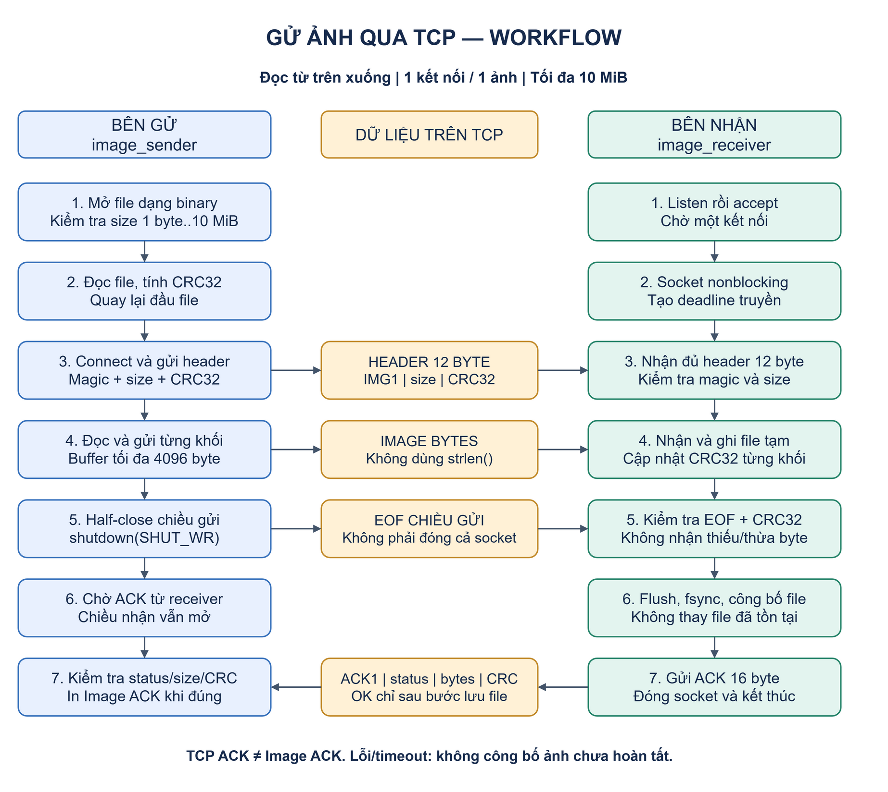
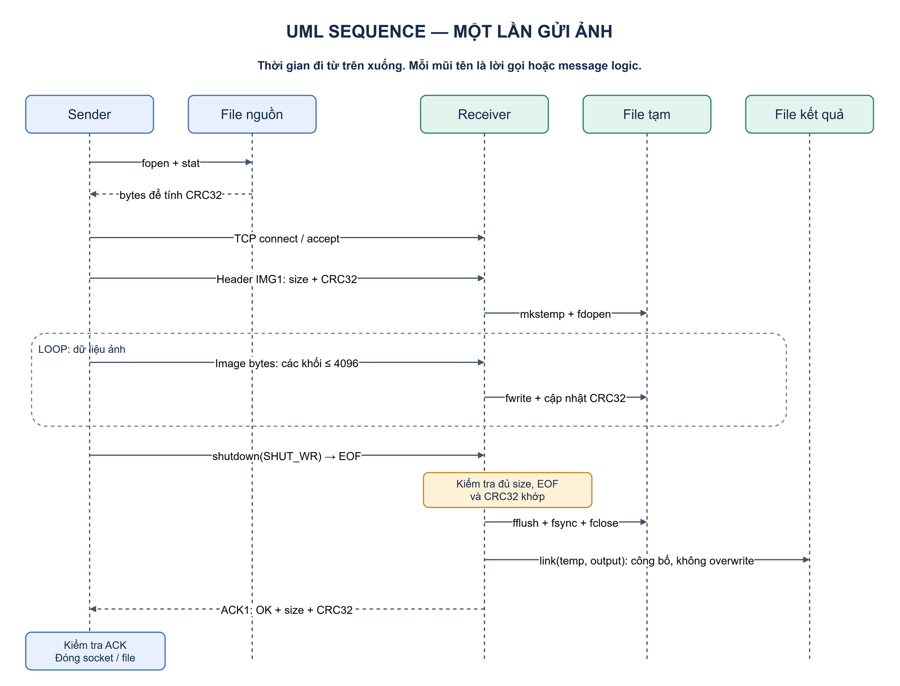
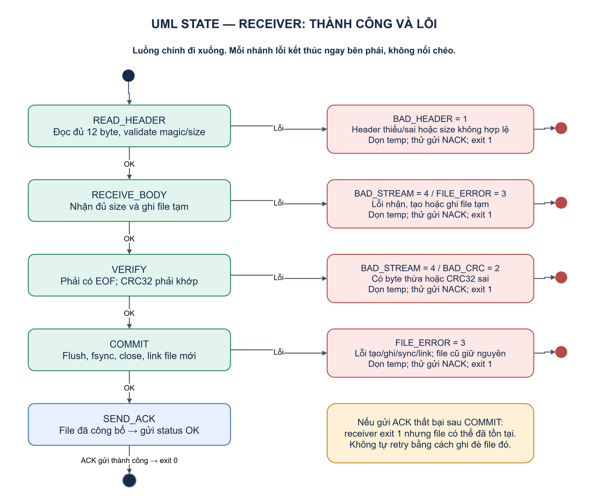

# TCP Image Transfer Lab — Gửi ảnh bằng C, giải thích code và UML

**Ngày:** 10/11/2026 · **Protocol:** IMG1 · **Target:** Linux · **Phạm vi:** một file ảnh qua một kết nối TCP.

Bản này bổ sung hai chương trình `image_sender` và `image_receiver`. Sender đọc ảnh từ ổ đĩa; receiver nhận, kiểm tra CRC32 và lưu đúng dữ liệu vào một file mới. Demo telemetry cũ vẫn dùng binary và giao thức riêng.

Các workflow/UML bên dưới là **ảnh PNG xuất bằng draw.io Desktop**, kèm source `.drawio` có thể chỉnh sửa. Không cần trình render Mermaid để đọc tài liệu này. Nhấp vào ảnh để xem kích thước đầy đủ.

## 1. Xem workflow trước

[](images/image-workflow.png)

[Mở source draw.io của workflow](diagrams/image-workflow.drawio).

Đọc hình từ trên xuống: cột xanh dương là sender, cột xanh lá là receiver, ở giữa là thông tin trao đổi qua TCP. Receiver bắt đầu listen trước khi sender connect. Sau khi gửi xong body, sender đóng **chiều gửi** để receiver thấy EOF, nhưng vẫn giữ chiều nhận để chờ kết quả.

## 2. Build và chạy ngay trên Linux

Trong Ubuntu, chạy tại gốc thư mục `linux_networking`:

```bash
sudo apt update
sudo apt install -y build-essential python3
make images
```

Không cần thư viện ảnh hay OpenSSL cho demo này. Dữ liệu JPG/PNG được truyền nguyên dạng byte, không giải mã pixel và không chuyển Base64 trên mạng.

Nếu chưa có ảnh để thử, tạo file PNG mẫu 1×1 pixel từ fixture trong repo:

```bash
python3 scripts/create_sample_image.py
mkdir -p received
```

Script tạo `inputs/sample.png` và từ chối ghi đè file mẫu đã có. Bạn có thể dùng một ảnh JPG/PNG của mình, tối đa 10 MiB.

**Terminal A — bên nhận, chạy trước:**

```bash
./build/image_receiver 127.0.0.1 5001 received/sample.png
```

**Terminal B — bên gửi:**

```bash
./build/image_sender 127.0.0.1 5001 inputs/sample.png
```

Kết quả mong đợi ở sender:

```text
Image ACK: bytes=... crc32=...
```

Receiver in `Saved ...` và kết thúc sau một transfer. Xác nhận nội dung độc lập với CRC của ứng dụng:

```bash
sha256sum inputs/sample.png received/sample.png
cmp inputs/sample.png received/sample.png
```

Hai SHA-256 phải giống nhau; `cmp` không in khác biệt và trả exit code 0. Mở `received/sample.png` bằng image viewer để kiểm tra. Khi gửi lại, chạy receiver mới và chọn tên output mới; chương trình không thay file đã tồn tại.

Gửi một ảnh thật, kể cả đường dẫn chứa khoảng trắng:

```bash
# Terminal A
./build/image_receiver 127.0.0.1 5001 'received/my photo.jpg'
```

```bash
# Terminal B: thay bằng đường dẫn ảnh thật trên Linux
./build/image_sender 127.0.0.1 5001 '/path/to/my photo.jpg'
```

CLI có tham số timeout tùy chọn theo millisecond:

```bash
./build/image_receiver 127.0.0.1 5001 received/another.png 60000
./build/image_sender 127.0.0.1 5001 inputs/sample.png 60000
```

Mặc định 30000 ms; khoảng được chấp nhận 100–600000 ms. Tham số này là deadline mạng của mỗi phía theo §6, không phải thời gian receiver được phép chờ ở `accept()`.

## 3. UML sequence: ai gọi ai, theo thứ tự nào?

[](images/image-sequence.png)

[Mở source draw.io UML sequence](diagrams/image-sequence.drawio).

Các lifeline đi từ trên xuống theo thời gian. Đây là sequence logic: nhiều lần `send` có thể được TCP gộp/chia khác nhau; hình không quy định mỗi mũi tên tương ứng một packet vật lý.

Điểm mấu chốt là thứ tự: **header → body → EOF chiều gửi → verify → publish file → ACK ứng dụng**. Sender chưa được báo thành công chỉ vì các lời gọi `send()` đã trả về.

## 4. Specification IMG1

### 4.1. Contract chung

| Thuộc tính | Giá trị |
| --- | --- |
| Sender CLI | `image_sender RECEIVER_IPV4 PORT INPUT_FILE [TIMEOUT_MS]` |
| Receiver CLI | `image_receiver BIND_IPV4 PORT OUTPUT_FILE [TIMEOUT_MS]` |
| Demo port | TCP 5001, cấu hình bằng CLI |
| Địa chỉ | IPv4 dạng số |
| Kích thước ảnh | 1–10485760 byte, tương đương tối đa 10 MiB |
| Application buffer | 4096 byte mỗi khối, không nạp toàn ảnh vào RAM |
| Một connection | Đúng một header và đúng một body; sender half-close sau body |
| Receiver process | Nhận một connection, xử lý một transfer rồi exit |
| Checksum | CRC-32/ISO-HDLC: polynomial reflected `0xEDB88320`, init/final XOR `0xFFFFFFFF` |
| Output path | Chọn ở receiver CLI; không nhận tên/path từ sender |
| Exit code | 0 khi thành công; 1 khi lỗi |

Chương trình vận chuyển binary file và không kiểm tra cấu trúc JPG/PNG. File tên `.jpg` vẫn có thể chứa dữ liệu khác; việc decode ảnh nằm ngoài phạm vi bản này. CRC32 giúp kiểm tra nội dung truyền theo contract, không phải cơ chế xác thực peer. SHA-256 trong lệnh kiểm chứng là phép đối chiếu độc lập bên ngoài chương trình.

### 4.2. Request header: 12 byte

| Offset | Byte | Field | Encoding |
| --- | --- | --- | --- |
| 0 | 4 | magic | ASCII `IMG1` |
| 4 | 4 | image_size | uint32 big-endian; chỉ tính body |
| 8 | 4 | image_crc32 | uint32 big-endian; checksum toàn body |
| 12 | image_size | image_data | Byte ảnh nguyên vẹn |

Golden vector độc lập với ảnh, dùng chuỗi `123456789` làm body 9 byte:

```text
49 4d 47 31  00 00 00 09  cb f4 39 26
   IMG1          size=9      CRC32
```

Sau header là đúng 9 byte ASCII của chuỗi đó, rồi EOF chiều gửi. Protocol cũng phải giữ nguyên mọi byte `0x00`; không dùng `strlen()` để tính dữ liệu file.

### 4.3. Response ACK: 16 byte

| Offset | Byte | Field | Ý nghĩa |
| --- | --- | --- | --- |
| 0 | 4 | magic | ASCII `ACK1` |
| 4 | 4 | status | uint32 big-endian, bảng bên dưới |
| 8 | 4 | written_bytes | uint32 big-endian; số byte đã ghi thành công qua `fwrite()` |
| 12 | 4 | actual_crc32 | uint32 big-endian; CRC đã hoàn tất, hoặc 0 nếu chưa tính xong |

| Status | Tên trong code | Ý nghĩa |
| --- | --- | --- |
| 0 | `IMAGE_OK` | Đủ size, EOF đúng, CRC khớp, hoàn tất publish file |
| 1 | `IMAGE_BAD_HEADER` | Header thiếu/sai magic hoặc size không hợp lệ |
| 2 | `IMAGE_BAD_CRC` | CRC của body không khớp header |
| 3 | `IMAGE_FILE_ERROR` | Lỗi tạo/ghi/flush/sync/close/link file |
| 4 | `IMAGE_BAD_STREAM` | Body thiếu, dữ liệu thừa, lỗi nhận hoặc hết deadline khi đang nhận body/EOF |

Sender chỉ in `Image ACK` khi ACK đủ 16 byte, magic/status hợp lệ, status = 0, size và CRC bằng giá trị đã gửi. Với status lỗi, `written_bytes` chỉ hỗ trợ debug và không có nghĩa output đã được công bố. Nếu header chỉ đọc được một phần thì vẫn thuộc bước BAD_HEADER.

ACK lỗi được gửi theo best effort: socket đã chết hoặc deadline đã hết thì có thể không gửi được. TCP ACK và `ACK1` là hai tầng khác nhau.

## 5. Giải thích code theo thứ tự đọc

### 5.1. `src/image_protocol.h` và `.c` — byte trên wire

Đọc [image_protocol.h](../src/image_protocol.h) trước để thấy constants/status, sau đó [image_protocol.c](../src/image_protocol.c).

| Hàm | Công việc | Vì sao cần? |
| --- | --- | --- |
| `put_u32/get_u32` | Encode/decode integer big-endian bằng byte shifts | Không phụ thuộc layout/padding của C struct |
| `image_crc_update` | Cập nhật CRC state theo một khối byte | Cho phép tính CRC khi đọc file dần |
| `image_crc_finish` | Final XOR một lần khi đã đọc hết | Phân biệt running state với checksum cuối |
| `image_header_encode/decode` | Tạo/kiểm tra magic, size, CRC | Hai phía dùng cùng contract 12 byte |
| `image_ack_encode/decode` | Tạo/kiểm tra phản hồi 16 byte | Sender xác nhận kết quả ứng dụng |

CRC state bắt đầu `IMAGE_CRC_INITIAL`; update nhiều lần rồi finish đúng một lần. Biên 0 và lớn hơn 10 MiB bị receiver từ chối trước khi tạo file tạm.

### 5.2. `src/image_io.c` — partial I/O và deadline

[image_io.c](../src/image_io.c) dùng `endpoint()` từ [net.c](../src/net.c) để kiểm tra IP/port. Nó không dùng `send_frame/recv_frame` của telemetry vì IMG1 có wire format và giới hạn khác.

| Hàm | Giải thích |
| --- | --- |
| `image_deadline` | Lấy clock monotonic hiện tại + timeout |
| `image_nonblocking` | Bật `O_NONBLOCK` qua `fcntl` |
| `image_connect` | Connect nonblocking; nếu EINPROGRESS thì chờ POLLOUT và đọc SO_ERROR |
| `time_left` | Tính thời gian còn lại so với cùng một deadline |
| `wait_ready` | Dùng `poll()` để chờ socket; không spin khi chưa sẵn sàng |
| `image_send_all` | Gửi phần còn thiếu; xử lý partial send, EINTR, EAGAIN và deadline |
| `image_recv_exact` | Đọc đủ số byte yêu cầu hoặc trả EOF/lỗi; xử lý partial recv tương tự |

Một client nhỏ giọt dữ liệu không được tự reset deadline sau mỗi byte. Đây là khác biệt so với việc chỉ đặt timeout cho từng syscall. `MSG_NOSIGNAL` trên send cho phép xử lý lỗi bằng giá trị trả về thay vì bị SIGPIPE kết thúc tại thao tác gửi đó.

### 5.3. `src/image_sender.c` — đọc file hai lượt

[image_sender.c](../src/image_sender.c) có ba phần:

1. `main()` parse CLI và mở file `rb`.
2. `inspect_file()` dùng `fstat()` kiểm tra regular file/size; đọc từng khối để tính CRC; kiểm tra số byte rồi `fseek()` về đầu.
3. `transmit()` gửi header, đọc/gửi body, `shutdown(SHUT_WR)`, nhận ACK và kiểm tra kết quả.

Lượt đọc thứ nhất để biết CRC trước khi gửi header; lượt thứ hai gửi dữ liệu. Vì vậy phải giữ input ổn định trong suốt transfer. Bản này chưa snapshot/lock file nguồn khi chương trình khác chỉnh sửa nó.

Không gọi `close()` ngay sau gửi body: đóng toàn socket sẽ làm mất đường nhận ACK. `shutdown(SHUT_WR)` thông báo hết dữ liệu ở một chiều, còn chiều receiver → sender vẫn dùng được.

### 5.4. `src/image_receiver.c` — nhận tạm rồi công bố

[image_receiver.c](../src/image_receiver.c) có `main()` setup listener và `receive_image()` thực hiện transfer:

1. Kiểm tra output chưa tồn tại bằng `lstat()`.
2. Listen/accept một connection, đóng listener, tạo deadline và bật nonblocking cho client socket.
3. Đọc đủ header, kiểm tra magic/size.
4. Tạo file `OUTPUT.part.XXXXXX` cùng thư mục bằng `mkstemp()`, rồi `fdopen(..., "wb")`.
5. Nhận/ghi từng khối và cập nhật CRC.
6. Nhận thêm một byte để kiểm tra EOF: EOF là đúng; byte thừa hoặc timeout là lỗi.
7. CRC khớp thì `fflush()`, `fsync()`, `fclose()`.
8. `link(temp, output)` tạo tên output mà không ghi đè đích đã có; bỏ tên temp bằng `unlink()`.
9. Gửi ACK và thoát. Các lỗi thông thường đi qua nhánh cleanup để đóng file và xóa temp.

Vì sao kiểm tra output hai lần? Kiểm tra đầu giúp báo lỗi sớm; `link()` ở bước cuối còn bảo vệ trường hợp một process khác tạo output trong lúc đang nhận. Hard link không thay tên đích đã tồn tại. [Linux link](https://man7.org/linux/man-pages/man2/link.2.html)

File tạm có tên ngẫu nhiên và được tạo độc quyền bởi `mkstemp()`. Cần thư mục output tin cậy, có quyền ghi và filesystem hỗ trợ hard link; ưu tiên filesystem Linux trong VM/WSL home. [Linux mkstemp](https://man7.org/linux/man-pages/man3/mkstemp.3.html)

`fflush/fsync` và publish ở đây chưa cam kết giữ được directory entry sau mất điện, vì chưa `fsync()` thư mục. Nếu ACK mất sau publish, file có thể đã lưu dù sender báo lỗi; không tự retry bằng cách ghi đè nó. [Linux fsync](https://man7.org/linux/man-pages/man2/fsync.2.html)

## 6. UML trạng thái và xử lý lỗi

[](images/image-receiver-states.png)

[Mở source draw.io UML state](diagrams/image-receiver-states.drawio).

Deadline sender bắt đầu **sau lượt inspect/hash**, trước connect, dùng chung đến ACK. Deadline receiver bắt đầu **sau accept**, dùng chung đến ACK. Thời gian chờ kết nối của listener không nằm trong deadline; bạn có thể Ctrl+C để dừng khi chưa có client.

File I/O và `fsync()` vẫn là thao tác blocking; đây là deadline mạng, không bảo đảm hard real-time cho toàn process hoặc ổ đĩa. Thời gian thực tế hai phía cũng không có cùng mốc bắt đầu tuyệt đối.

SIGKILL, Ctrl+C giữa lúc xử lý hoặc crash có thể để lại `.part.*`; chưa có signal handler/recovery scanner. Nhánh cleanup xử lý lỗi bình thường không đồng nghĩa chống được mọi trường hợp process chết đột ngột.

## 7. Chạy qua network namespaces

Dùng topology hiện có trong `scripts/lab.sh`; không cần thay IP host:

```bash
sudo bash scripts/lab.sh up
mkdir -p received captures
```

**Terminal A:**

```bash
sudo ip netns exec eln-gw ./build/image_receiver 10.22.0.2 5001 received/namespace.png
```

**Terminal B — bắt gói trước khi gửi:**

```bash
sudo ip netns exec eln-ecu tcpdump -i eln-e0 -nn -s 0 -U -w captures/image.pcap 'tcp port 5001'
```

**Terminal C:**

```bash
sudo ip netns exec eln-ecu ./build/image_sender 10.22.0.2 5001 inputs/sample.png
sudo sha256sum inputs/sample.png received/namespace.png
```

Receiver được chạy bằng sudo nên file output có thể thuộc root, quyền 0600. Để mở bằng image viewer của user hiện tại sau khi transfer:

```bash
sudo chown "$(id -u):$(id -g)" received/namespace.png
```

Dừng tcpdump bằng Ctrl+C, mở pcap bằng Wireshark, Follow TCP Stream và tìm `IMG1`, size/CRC, body, FIN chiều sender và `ACK1` từ receiver. Packet boundaries có thể khác application chunks.

Thử `sudo bash scripts/lab.sh delay`, gửi lại vào một output mới rồi `clear`. Với ảnh lớn có thể cần tăng deadline CLI. Sau khi dừng mọi process trong namespace, chạy `sudo bash scripts/lab.sh down`.

## 8. Test và trạng thái kiểm chứng

```bash
# Chỉ bản gửi ảnh
make test-images

# Toàn project: telemetry + ảnh
make test
```

| Nhóm | Kiểm tra |
| --- | --- |
| C protocol | CRC vector `123456789`, CRC chia khối, header/ACK golden vectors, magic/status/size lỗi |
| C sender ↔ C receiver | Gửi PNG thật và so bytes |
| Python peer ↔ C receiver | Binary >1024 byte chứa NUL, fragmented sends, size đúng 10 MiB |
| Error paths | Sai CRC/header/size, body thiếu, byte thừa, slow header vượt deadline |
| Filesystem | Output cũ giữ nguyên, output xuất hiện khi đang transfer, thư mục đích thiếu |
| Fake receiver ↔ C sender | ACK sai magic, negative status, sai size/CRC, ACK thiếu |

Source test: [C protocol vectors](../tests/test_image_protocol.c), [integration tests](../tests/test_image_transfer.py). Có **13 integration test methods** cho image transfer; một số method có nhiều subcase.

**Đã kiểm chứng ở phiên tạo bản này:** cross-build thành công cả hai binary Linux x86_64/musl với C11 và `-Wall -Wextra -Wpedantic -Werror`; build và chạy test C protocol trên Windows; kiểm tra fixture PNG, cú pháp Python và xuất/kiểm tra hình draw.io.

**Chưa kiểm chứng:** chạy hai chương trình C và integration tests trong Linux, capture và netem. Máy làm việc hiện chưa có Linux runtime dùng được. Cross-build không thay cho runtime test; chạy các lệnh test phía trên khi mở Ubuntu.

## 9. Chỉnh sửa sơ đồ draw.io

Mở file `.drawio` bằng draw.io Desktop hoặc diagrams.net, sửa trực tiếp và export PNG. Tài liệu đang dùng PNG theo đường dẫn tương đối nên cập nhật ảnh là đủ để thấy hình mới.

Ba source nằm trong `docs/diagrams/`; PNG tương ứng nằm trong `docs/images/`. Script [generate_image_drawio.py](../scripts/generate_image_drawio.py) tạo lại source từ layout có sẵn; nếu đã chỉnh tay, đừng chạy lại script để tránh ghi đè chỉnh sửa.

CLI draw.io Desktop để tái xuất một hình, thay `drawio` bằng đường dẫn executable nếu cần:

```bash
drawio --export --format png --scale 1.5 --border 24 \
  --output docs/images/image-workflow.png \
  docs/diagrams/image-workflow.drawio
```

## 10. Học tiếp từ bản này

Bắt đầu bằng đọc `image_protocol` → `image_sender` → `image_receiver` → `image_io`, mở workflow bên cạnh code. Tự dự đoán ứng dụng sẽ làm gì khi thiếu một byte hoặc CRC sai rồi chạy test tương ứng.

Các bước tiếp theo phù hợp: progress theo số byte; nhiều ảnh tuần tự; metadata có tên/format được kiểm soát; resume với transfer ID và offset; concurrency khi server nhận nhiều client. Streaming camera thời gian thực là bài toán khác với gửi một file ảnh; cần chọn latency/bandwidth/drop policy theo yêu cầu mới.
