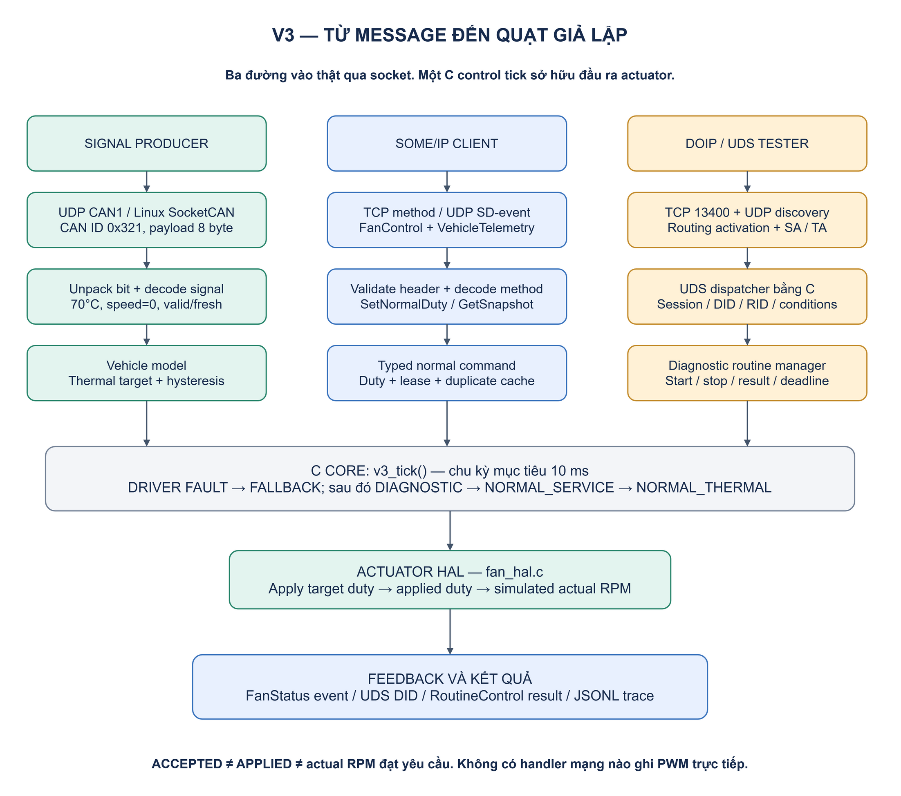
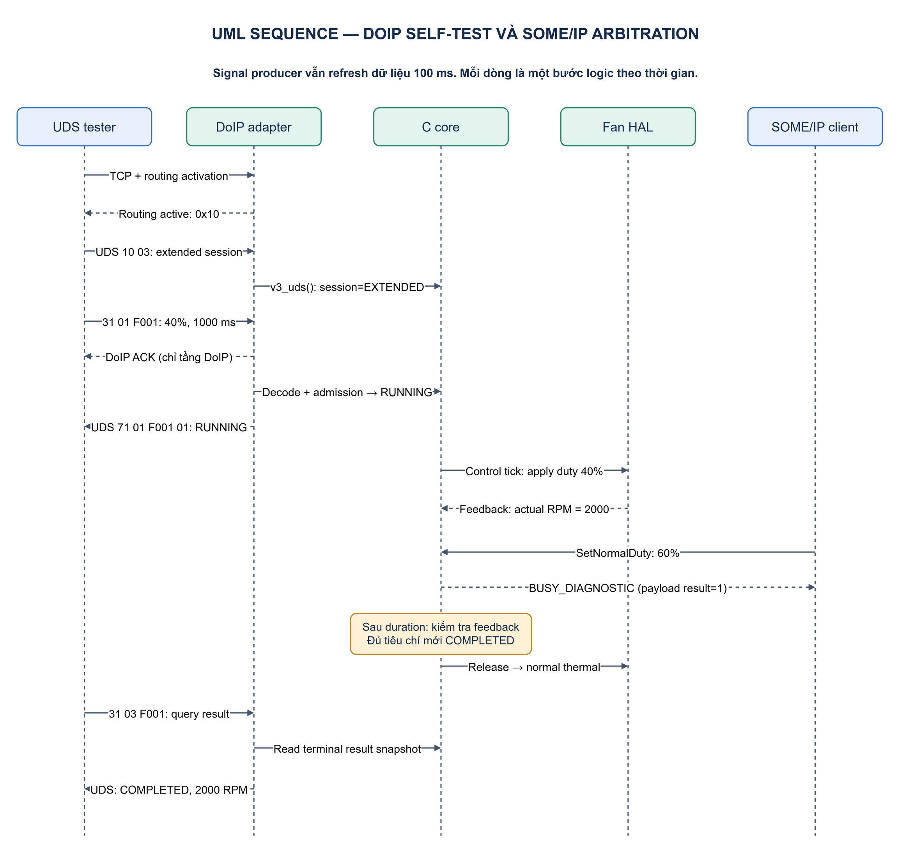
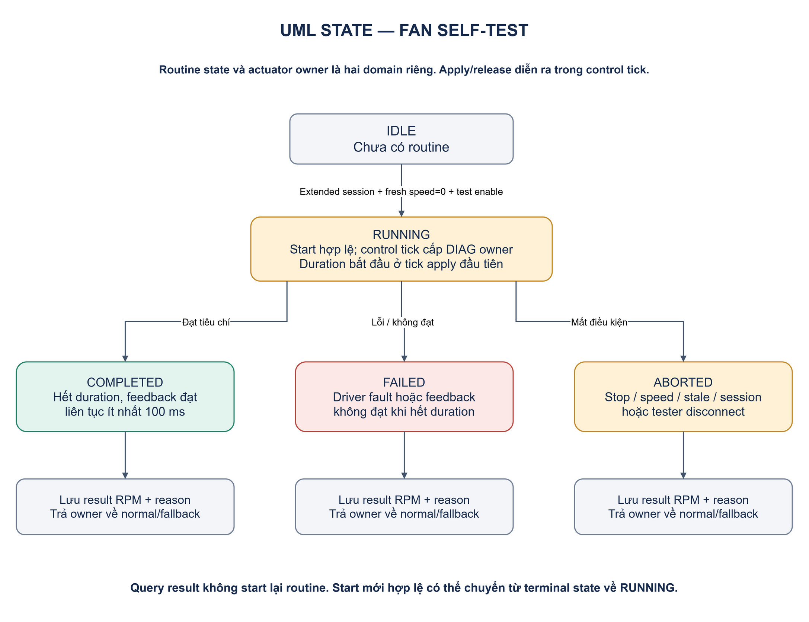

# V3 đã triển khai — Virtual ECU Diagnostic & Actuation Lab

**Cập nhật:** 14/11/2026 · **Chạy trên:** Windows/Python và Linux/Python · **Control core:** C11.

Bản này thực hiện luồng đã thiết kế: signal → unpack/decode → model → controller/arbiter → actuator HAL → feedback; DoIP/UDS và SOME/IP cùng truy cập một ECU quạt giả lập. [Tài liệu lý thuyết và contract](03-doip-signal-actuator.md) vẫn là nguồn giải thích nền; tài liệu hiện tại mô tả implementation và cách chạy thật.

## 1. Workflow thực tế

[](images/v3-workflow.png)

[Source draw.io có thể sửa](diagrams/v3-workflow.drawio).

Network adapters là Python standard library; signal codec, UDS service handler, session timer, routine state machine, duplicate cache, arbitration và actuator simulator đều chạy bằng C qua shared library. Một asyncio loop tuần tự gọi C; không có nhiều thread cùng ghi vào core. Thread signal publisher chỉ gửi UDP.

Đây là protocol subset cho lab, **không phải AUTOSAR Classic/Adaptive stack đầy đủ**, không dùng `vsomeip` hay `ara::com` trong runtime hiện tại. Điều này cho phép chạy và quan sát ngay trên máy Windows, đồng thời giữ phần điều khiển C để học embedded và chuyển port sau này.

## 2. Demo hoàn chỉnh bằng hai lệnh

Chạy ở gốc `linux_networking`, không cần quyền Administrator:

```powershell
python -m advanced.build
python -m advanced demo
```

Lệnh build tìm `CC`, `cc`, hoặc toolchain Zig đã có trong workspace này. Nếu máy khác chưa có compiler, cài C compiler hoặc truyền đường dẫn Zig:

```powershell
python -m advanced.build --cc 'C:\path\to\zig.exe'
```

Trên Ubuntu:

```bash
sudo apt install -y build-essential python3
make v3
python3 -m advanced demo
```

Cần Python 3.10 trở lên. Runtime không yêu cầu pip package ngoài standard library. Demo tự khởi động ECU trên loopback với port trống, phát signal 10 Hz, chạy tester và service client, sau đó shutdown các process. Không đụng route/firewall của host và không ghi hardware actuator.

Các bước demo kiểm tra thật:

1. UDP vehicle identification trả VIN/logical address của virtual ECU.
2. Signal nhiệt độ 70°C, speed 0 → NORMAL_THERMAL, duty 40%, actual 2000 RPM.
3. SOME/IP-SD Find/Offer/Subscribe → nhận FanStatus UDP event.
4. SOME/IP `SetNormalDuty(25%)` → NORMAL_SERVICE, actual 1250 RPM.
5. DoIP activation; UDS đọc DID nhiệt độ và chuyển extended session.
6. UDS `FanSelfTest(40%, 1000 ms)` trả RUNNING.
7. SOME/IP command 60% trong lúc routine chạy trả BUSY_DIAGNOSTIC.
8. Query routine trả COMPLETED với snapshot 2000 RPM.
9. Actuator owner trở lại NORMAL_THERMAL; normal service lease cũ không được khôi phục.

Output cuối phải có `"stage": "DEMO_PASS"`. Demo in đường dẫn trace thật tại `artifacts/v3/ecu-<boot_id>.jsonl`. Nếu một bước không đạt, command thoát với lỗi; không chỉ in một chuỗi kết quả mô phỏng sẵn.

## 3. Chạy từng process để học

### Terminal A — ECU

```powershell
python -m advanced ecu --test-enable
```

Server in một dòng JSON `READY` gồm IP, các port và file trace. Cờ `--test-enable` cho phép self-test của simulator; nếu không có cờ, các đường đọc dữ liệu vẫn chạy nhưng routine bị từ chối. Nó không thay một cơ chế UDS security/authentication thật.

### Terminal B — signal producer

```powershell
python -m advanced signal --temperature 70 --speed 0
```

Producer refresh mỗi 100 ms đến khi Ctrl+C. UDP envelope `CAN1` chỉ là **tunnel PDU của lab**, không phải CAN-over-Ethernet standard. Bên trong vẫn là payload signal 8 byte đúng schema `0x321` trong tài liệu lý thuyết.

### Terminal C — đọc và điều khiển

```powershell
python -m advanced status
python -m advanced diag --request '22 f2 00'
python -m advanced snapshot
python -m advanced events --count 10
python -m advanced set-duty 25 --lease 1000
python -m advanced diag --self-test 40 --duration 1000
```

Lệnh `diag --self-test` giữ **cùng một connection**, tự chuyển extended session, start và query đến terminal result. Hai lần chạy CLI độc lập không dùng chung session. Một raw start request rồi đóng tester sẽ làm routine bị abort khi ECU phát hiện disconnect.

Mỗi normal service command có lease tối đa 2 giây. Hết lease sẽ về thermal/fallback; `set-duty` không cấp quyền vĩnh viễn. CLI tạo command ID mới mặc định; chỉ truyền `--id` khi chủ ý thử replay/conflict.

### Thử mất signal hoặc fault

Dừng Terminal B trong khi self-test đang chạy: sau signal timeout 300 ms, routine ABORTED và simulator về fallback. Chạy lại producer để cập nhật dữ liệu mới.

Thử một process ECU riêng với plant bị stall:

```powershell
python -m advanced ecu --test-enable --fault 2
```

Giữ producer chạy và thực hiện self-test. Duty vẫn có thể được apply, nhưng actual RPM bằng 0 nên routine FAILED. `--fault 1` mô phỏng lỗi driver đã biết: fallback 0 và từ chối start mới. Những lựa chọn fallback/duty này chỉ phục vụ simulator.

## 4. Port và wire contract được triển khai

| Endpoint mặc định | Công việc |
| --- | --- |
| TCP/UDP 13400 | DoIP diagnostic + vehicle identification/entity status |
| UDP 32001 | Tunnel signal lab `CAN1 + CAN_ID:uint32 BE + DLC:uint8 + payload8` |
| TCP 30511 | FanControlService `0x1235`, instance `0x0001`, major/minor `1.0` |
| TCP 30501 | VehicleTelemetryService `0x1234`, method GetSnapshot `0x0001` |
| UDP 30512 / 30502 | FanStatus / TelemetryUpdated notifications |
| UDP 30490 | SOME/IP-SD unicast Find/Offer/Subscribe/Ack |

SOME/IP FanControl methods: `0x0001 SetNormalDuty` có request 8 byte và response 6 byte; `0x0002 ReadFanStatus` nhận payload rỗng, trả 16 byte. Method 2 là tiện ích được thêm khi triển khai để kiểm tra state mà không phụ thuộc event subscription.

Event ID `0x8001`, eventgroup `0x0001` áp dụng cho từng service. Telemetry payload 20 byte và FanStatus 16 byte giữ encoding big-endian đã định nghĩa. `status_sequence` tăng theo control tick, không phải counter số event được giao; không dùng gap của nó để kết luận UDP packet loss.

SD của bản này dùng **unicast**: consumer mặc định bind `127.0.0.2:30490`, provider `127.0.0.1:30490`. Cùng số port, khác địa chỉ. Offer trả endpoint TCP/UDP; Subscribe có endpoint nhận event riêng; TTL tối đa 3 s và consumer renew mỗi khoảng 1 s khi gọi `receive()`. Hết TTL thì server dừng gửi. Chưa có multicast cyclic offers, đầy đủ reboot handling hoặc mọi option/state machine SD.

Khi chạy trên hai máy/Linux namespace, dùng địa chỉ thật ở `--host` của ECU và `--local-ip` của event consumer; `--local-ip` phải là IP thực sự bind được tại consumer. Ví dụ:

```bash
python3 -m advanced ecu --host 10.23.0.12 --test-enable
python3 -m advanced events --host 10.23.0.12 --local-ip 10.23.0.10
```

Các địa chỉ trên cần được bạn cấu hình trước. `scripts/lab.sh` cũ tạo topology V1, không tự tạo ba namespace V3.

## 5. DoIP/UDS: receive đến actuator

[](images/v3-diagnostic-sequence.png)

[Source draw.io sequence](diagrams/v3-diagnostic-sequence.drawio).

Ví dụ request vẫn là:

```text
03 fc 80 01 00 00 00 0c 0e 00 00 01 31 01 f0 01 0f a0 03 e8
```

Luồng code thực tế:

| Bước | File/hàm | Output |
| --- | --- | --- |
| Receive/reassemble | `protocol.read_frame()` | Đủ DoIP header/body; có frame assembly deadline |
| Validate/routing | `ecu.handle_doip()` | Routing active, đúng source/target; protocol ACK/NACK |
| Dispatch/decode | C `v3_uds()` | SID/subfunction/RID và duty/duration được giải mã |
| Admission | C `v3_uds()` | Session/test flag/fresh speed/fault/range hợp lệ hoặc NRC |
| Accept routine | C core | RUNNING, diagnostic owner request; chưa ghi output |
| Arbitrate/execute | C `v3_tick()` | Chọn target và gọi `v3_fan_apply()` |
| Actuator feedback | C `fan_hal.c` | Applied duty và actual RPM của simulator |
| Result | C core + DoIP adapter | Terminal RPM snapshot và UDS response |

Protocol DoIP nhận version 2 và 3; phản hồi theo version request. Header version/inverse, max body 4096 byte và logical address được kiểm tra trước UDS. UDP discovery còn nhận version `0xFF` trong identification. Routing activation chỉ hỗ trợ default activation type 0 và tester SA trong `0x0E00..0x0FFF`; một SA không được đồng thời đăng ký trên hai connection.

UDS hỗ trợ `0x10`, `0x22` (một DID/request), `0x3E`, `0x31`. Positive suppression bit được xử lý cho các service có subfunction; negative response vẫn được gửi. `0x2F`, SecurityAccess, flashing và các service khác chưa triển khai. Routine bất đồng bộ được accept nhanh, rồi query bằng subfunction 3; không dùng response pending `0x78` để thay cho trạng thái RUNNING.

Server phát DoIP AliveCheck sau idle và chờ reply; UDS S3 timer vẫn độc lập. TCP giữ kết nối không có nghĩa session extended còn hiệu lực. P2/P2* công bố trong response session là 50/5000 ms; Python event loop không được chứng nhận đáp ứng hard real-time.

## 6. Routine state và quyền actuator

[](images/v3-routine-states.png)

[Source draw.io state](diagrams/v3-routine-states.drawio).

`v3_tick()` là nơi duy nhất apply output. Network callback chỉ decode và cập nhật model/request state. Sau start accepted, duration bắt đầu tại control tick apply đầu tiên. Với simulator, feedback phải trong khoảng expected RPM ±10% liên tục ít nhất 100 ms trước khi kết thúc duration mới COMPLETED.

Disconnect hoặc stop có thể đổi routine state sang ABORTED trước khi tick tiếp theo release output. Vì vậy đọc được ABORTED không tự chứng minh physical/applied output đã đổi trong cùng microsecond; quan sát cả owner/applied/actual. Mục tiêu tick là 10 ms, nhưng timing trên OS thực tế phải đo.

Priority thực tế: driver fault → FALLBACK; hợp lệ thì DIAGNOSTIC → NORMAL_SERVICE còn lease → NORMAL_THERMAL còn fresh → FALLBACK. Normal service không yêu cầu signal nhiệt độ để cấp một setpoint hợp lệ; diagnostic yêu cầu speed valid/fresh bằng 0 và thermal controller yêu cầu sample fresh.

Replay cache cố định 16 entry, cửa sổ 10 s, key `(IPv4 + SOME/IP client_id, command_id)` trong một runtime epoch. Cùng ID/payload trả kết quả cũ **không kéo dài lease**; khác payload là INVALID. Entry bị eviction hoặc hết cửa sổ không còn được bảo vệ replay. Đây không phải exactly-once delivery toàn hệ thống hoặc cơ chế xác thực client.

## 7. Đọc code và trace theo một message

| File | Trách nhiệm |
| --- | --- |
| [core/ecu_core.c](../advanced/core/ecu_core.c) | Signal model, UDS/session, routine, cache, arbiter và control tick |
| [core/fan_hal.c](../advanced/core/fan_hal.c) | Port actuator simulator; điểm thay bằng hardware port về sau |
| [core.py](../advanced/core.py) | ctypes signatures và chuyển bytes/clock qua C |
| [protocol.py](../advanced/protocol.py) | Wire codec, TCP framing/deadline, SOME/IP-SD subset |
| [ecu.py](../advanced/ecu.py) | Socket adapters, control task 10 ms, subscription TTL, trace |
| [client.py](../advanced/client.py) | Tester, signal producer và service/event consumers |
| [__main__.py](../advanced/__main__.py) | CLI và demo end-to-end |

Mỗi dòng trace có monotonic timestamp, boot_id, trace ID và stage. Tìm một start request:

```powershell
python -m advanced.trace_view 'artifacts/v3/ecu-XXXXXXXX.jsonl' --stage UDS
```

Lấy `trace=N` của request `3101f001...`, rồi theo toàn bộ luồng:

```powershell
python -m advanced.trace_view 'artifacts/v3/ecu-XXXXXXXX.jsonl' --trace N
```

Các stage cần thấy: `RX_DOIP`, `UDS`, `ADMISSION`, `ARBITER`, `APPLY`, `FEEDBACK`, `ROUTINE`. Signal có `RX_SIGNAL`, `UNPACK`, `DECODE`; normal service có `RX_SOMEIP`, `SERVICE_COMMAND`. Trace là log thực thi nội bộ, không được gọi là packet capture.

Code C dùng clock được caller truyền vào để unit test timer xác định, không phải đợi 5 giây thật. Network integration tests dùng clock và socket thật. Tách hai loại test giúp phân biệt lỗi state machine với lỗi transport.

## 8. SocketCAN trên Linux

Đầu vào SocketCAN đã có code, cần Linux/kernel có vcan. Tạo một interface mới dành cho lab:

```bash
sudo modprobe vcan
sudo ip link add vcan-v3 type vcan
sudo ip link set vcan-v3 up
python3 -m advanced ecu --test-enable --can-interface vcan-v3
```

Terminal khác:

```bash
python3 -m advanced signal --can-interface vcan-v3 --temperature 70 --speed 0
python3 -m advanced diag --self-test 40 --duration 1000
```

Producer và receiver phải truy cập cùng vcan network namespace. Dừng các process trước khi dọn interface bằng `sudo ip link del vcan-v3`. Không tạo lại interface nếu tên đó đã được một lab khác dùng. Nhánh này chưa chạy thực tế trong phiên Windows; không suy diễn kết quả UDP tunnel thành kết quả vcan.

## 9. Test và kiểm tra độc lập

```powershell
python -m advanced.build
python -m unittest discover -s advanced/tests -v
```

Linux có thể dùng `make test-v3`; `make test` cũng chạy thêm nhóm V3. Test bao gồm C core với fake clock, protocol vectors/framing và integration qua process/socket thực.

Kiểm tra độc lập với implementation của bên khác là bước tùy chọn:

```bash
python -m pip install -r advanced/requirements-interop.txt
python -m advanced.verify_interop
```

Các package này chỉ dùng kiểm tra, không phải dependency runtime. Bài interop dùng `doipclient` + `udsoncan` để đọc DID/chạy routine và `someip` để tự build request TCP, SD Find/Subscribe, parse Offer/Ack và nhận event UDP. Nó kiểm tra subset đã công bố, không chứng minh đầy đủ conform AUTOSAR/ISO.

Xem [báo cáo kiểm chứng](v3-validation.md) để biết chính xác test nào đã chạy, trên môi trường nào, và phần nào còn chưa kiểm chứng.

## 10. Khác biệt với spec ý tưởng ban đầu

| Ý tưởng ban đầu | Implementation hiện tại |
| --- | --- |
| Network adapter C/C++/vsomeip | Python standard library với wire subset; C giữ toàn bộ control/codec/UDS/HAL |
| Queue 16 command | Không có hàng đợi command ứng dụng: event loop dispatch đồng bộ, không ACK một command bị queue mất; 16 là replay cache |
| Full service discovery | Unicast Find/Offer/Subscribe/renew/TTL; chưa multicast cyclic Offer/full SD lifecycle |
| Event khi state đổi và định kỳ | Initial event sau subscribe, sau đó mục tiêu mỗi 100 ms; trace ghi thay đổi state ở control tick |
| Namespace topology V3 | Loopback đã chạy; địa chỉ cấu hình được; script tạo topology V3 riêng chưa có |
| AUTOSAR integration | Mapping trách nhiệm để học; chưa ARXML/code generation/RTE/BSW thương mại |
| Actuator hardware | Fan HAL simulator, có driver/stall fault injection; chưa GPIO/PWM vật lý |

Bước học tiếp phù hợp là chạy demo, tìm trace của một routine rồi đọc `v3_uds()` và `v3_tick()` cạnh workflow. Sau khi hiểu core mới thay transport adapter bằng `vsomeip` hoặc port application sang stack AUTOSAR cụ thể.
